# Stoa

**The CRM for [Hermes Agent](https://github.com/NousResearch/hermes-agent): a lightweight one you talk to. Hermes runs it; you approve.**

A two-person sales team does not need a CRM with forty tabs. It needs to know who to sell to,
the pipeline kept honest, the follow-ups written, and the calls turned into next steps, in the
places the team already works. Tell it what happened, send it a list, or press a button, and it
keeps the pipeline. Stoa is that, in one plugin:

**Map the market → find the leads → run the pipeline → see what is working.**

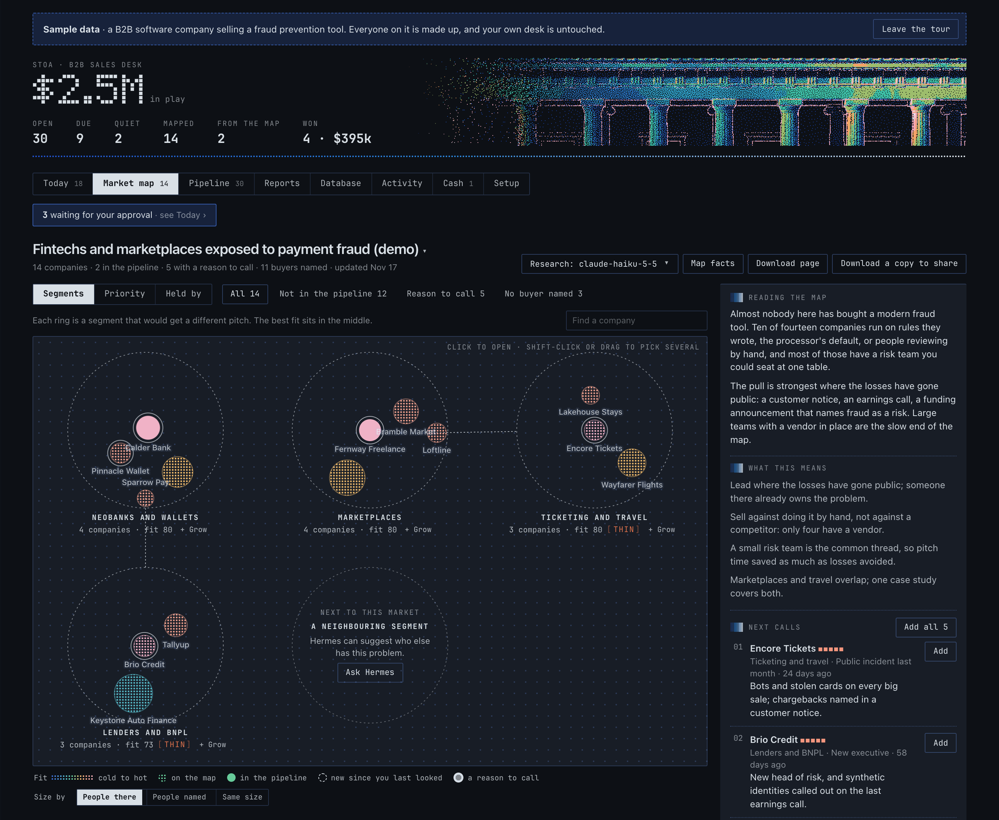

```
hermes plugins install jarrett-del/hermes-stoa
hermes plugins enable stoa
hermes gateway restart
```

Then switch it on under **Capabilities → Plugins** in the Hermes Desktop app or Webapp, and open
**Stoa** in the sidebar. [Set up in five minutes](#set-up-in-five-minutes) has the rest.

**On this page:** [The market map](#the-market-map) · [The pipeline](#the-pipeline) ·
[Reports](#reports) · [The database](#the-database) · [Hermes proposes, you approve](#hermes-proposes-you-approve) ·
[The rest of the desk](#the-rest-of-the-desk) · [Set up](#set-up-in-five-minutes) · [Read more](#read-more) ·
[Disclosure](#disclosure)

Every picture here shows the sample data that comes with the tour. Every person and company in it
is made up.

## The market map

Say what you sell and who you are after. Hermes names the market, splits it into segments that
would each get a different pitch, researches the companies, checks every one against your
requirements with the evidence and its source, and saves the map. Then it is yours to work.

### Read it three ways

- **Segments** shows who is where: a ring for each segment, the best fit in the middle.
- **Priority** puts fit against how fresh the reason to call is, so the top right is who to call
  first.
- **Held by** groups companies by what they use today, so you can see who you would be replacing.

Click a company and it opens beside the map: why it fits, each requirement with its evidence,
headcount, what it uses today, the buyer, the source. Under the map, **What matters** weighs each
requirement (off, nice to have, matters, must) and the map re-scores on the spot.


### Act on what you see

Shift-click, drag across the map, or tick rows in the table to pick several. One press adds them
to the pipeline, names a buyer at each, or has Hermes draft the first note from the evidence. A
company that is already in your pipeline is filled in from the map, not added a second time.

Grow the map the same way: **+ Grow** under a segment, **More like these** on the companies you
picked, or the faint ring beside the map for a neighbouring segment. Hermes finds more and checks
each one against the same requirements.

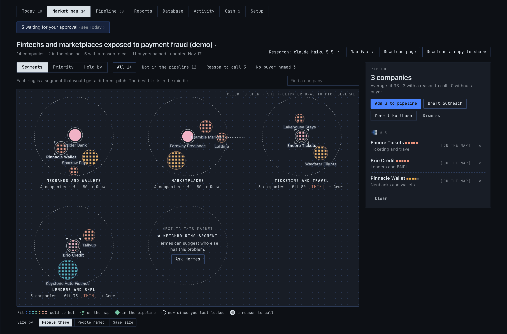

### Manage your maps

The map's name is a list. Press it to switch maps, start a **New map** (say what you sell and who
to, and Hermes goes and maps it), **Rename** this one, or **Delete** it. Only a person at the page
can delete a map; Hermes has no way to.

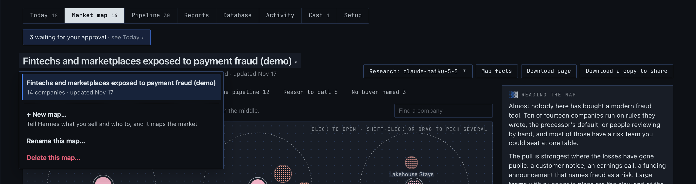

**Pick the model that researches it.** **Research:** sets the model Hermes uses to start a map,
grow it and fill in what is missing. It runs in a conversation of its own, apart from the model
the talk box at the foot of the page runs on, so the desk can run on a small model while maps are
researched on a large one, or the other way round. The list is every model your Hermes can use.

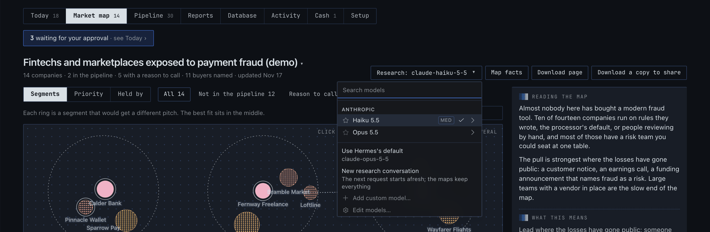

**Know what a map holds and what it cost.** **Map facts** shows how complete the map is, where
its evidence came from, and what Hermes's work on it has cost by Hermes's own estimate, with paid
lookups and searches beside it. Set limits there: companies, dollars a month, lookups, searches.
At a limit Stoa refuses the next step and tells Hermes to stop and tell you.


**Hand it to a client.** **Download a copy to share** saves the whole map as one web page with
the same working map at its head, without buyers' names or your pipeline. Host it or send it.


## The pipeline

A funnel that says how many records got as far as each stage and what share went on to the next,
over a board you work by hand or by talking. Drag a card to move it, or press its button: the
stage changes at once, with no model in the loop, no waiting and no wrong stage. The same click
can hand the follow-up (the outreach note, the proposal email, the decline) to Hermes to write.

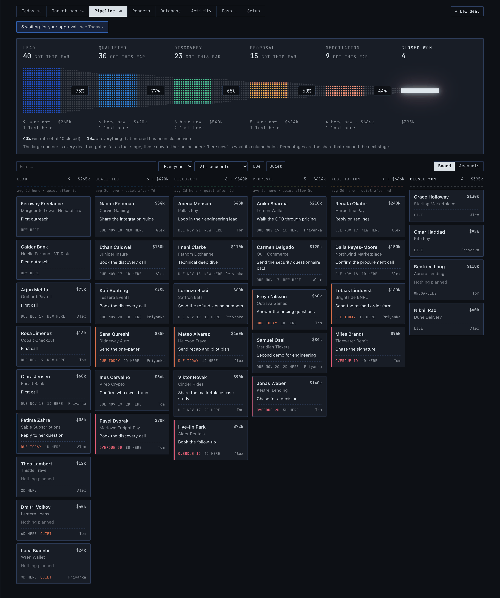

**A card says what you need to know.** The contact, the next step in full, when it is due or how
far overdue, how long the record has sat in its stage, whether it has gone quiet, and who owns it.
A card that is due has a coloured edge. Rest the pointer on one and a panel opens beside it: the
people on it, the notes, and the last few things logged.

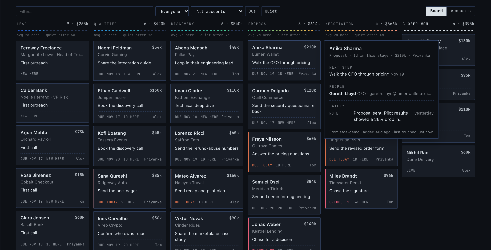

**A page for each record.** Press a record anywhere and it opens laid out the way a CRM is read:
the stages as one bar (press a stage to move it there), the next step with **Done**, **Change**,
**Draft follow-up** and **Snooze**, every fact on the left, notes, people and activity in the
middle, and what it is connected to on the right.

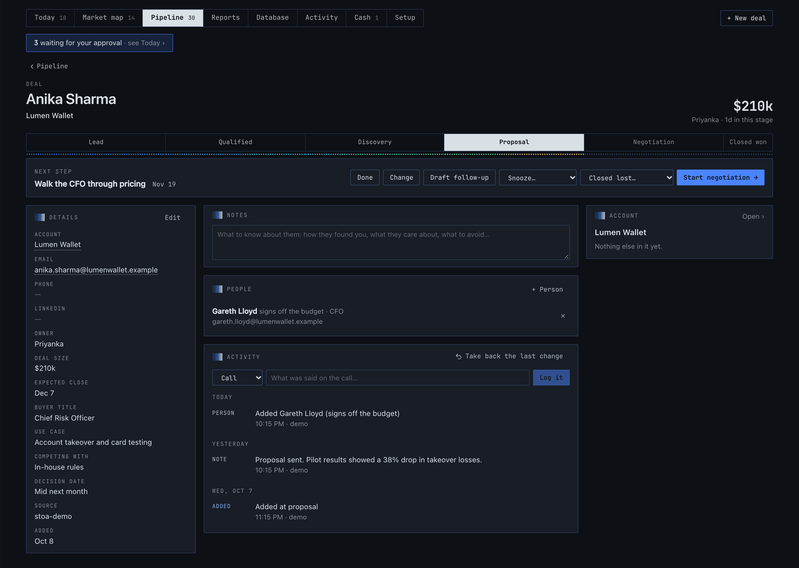

**Today is the list you start with.** What is waiting for your approval, what is overdue and due
today, invoices gone late, wins nobody has billed, records gone quiet and new ones with nothing
planned. Each row has one move.

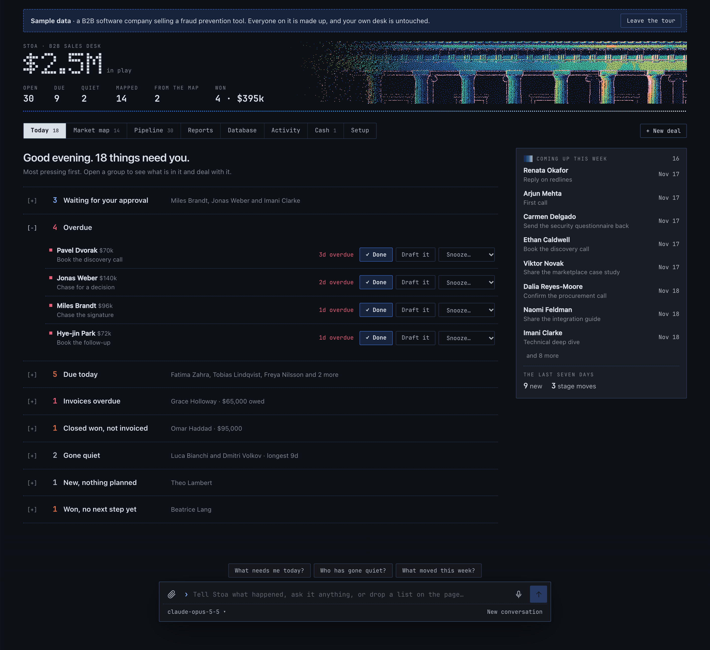

## Reports

The desk added up. Stoa counts every figure itself from your records, so a report costs nothing
to open, reads the same each time, and never depends on a model getting a sum right.

Seven are on the dashboard to begin with: pipeline by stage, win rate, time in stage, where
records come from, why they were lost, what the market map turned into, and what Hermes proposed
and what you did with it. Each card carries one sentence on what its figures say. Pick a period
and set it against the one before.


Open a report to see it large. Press a bar and the records behind it are listed, each a press
away. **How this report is made** says in plain lines what it counts. Make your own from a few
choices with **+ New report**, or ask in plain words (*"win rate by owner this quarter"*) and
Hermes saves it as a draft for you to keep or discard. Hermes is used once, to make the report.
After that Stoa works it out.


## The database

The pipeline shows work by stage. The database is everything the desk keeps, as tables to look
through: **Accounts** (every company with a record, and every company on a market map), **Deals**
(every record, open, won or lost) and **People** (each person once, however many records they
are on).

Search, filter, sort, group, and choose the columns. The boxes above the table count the rows by
stage and narrow to one when pressed. A handful of views come with it (*Open*, *Due this week*,
*No next step*, *Quiet for two weeks*, *After the win*, *Customers*); **Save as a view** keeps
the filters, sort and columns in front of you as a view of your own.


**Change it where it is.** Press a cell (an owner, a deal size, a next step and its date, a
stage, a person's title or email) and type. Each change is logged on its record with **Undo**
offered, as if made on the record's own page. Tick rows and one bar makes the same change to all
of them: set the owner, move the stage, set the next step, close them as lost. **Copy emails**
and **Export CSV** take the ticked rows, or every row shown.

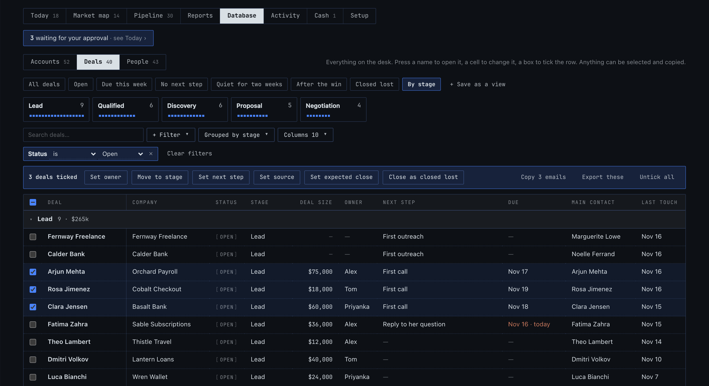

**The map and the pipeline meet here.** *On a map, not in the pipeline* lists the companies you
have mapped and not yet worked, with their fit and signal. Tick the ones you want and add them.

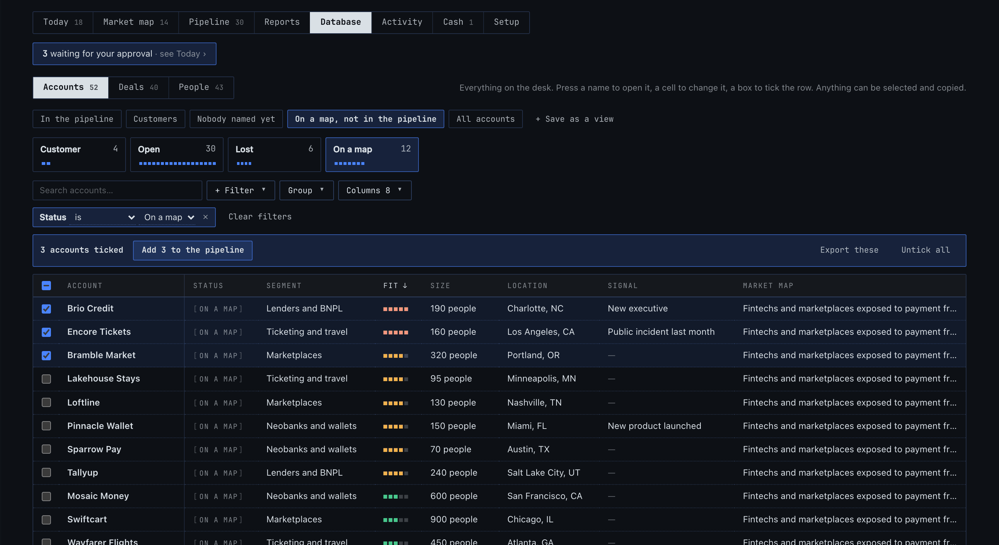

## Hermes proposes, you approve

What Hermes finds in your email, calls and Slack is logged on the right record. Anything more (a
stage it thinks should move, a person to add, a list you sent in) waits on Today for your yes or
no, with the evidence beside it in their words.

- **A no is remembered.** A declined suggestion is not made again.
- **Everything can be taken back.** Every change is kept on a ledger with what it replaced, and
  **Undo** is offered after anything you, Hermes or a Slack button did.
- **A scheduled job cannot outrun you.** One setting says what a job may change when you are not
  there. It starts on **Ask me first**, it is enforced in the plugin and not in a prompt, and
  only you can change it.

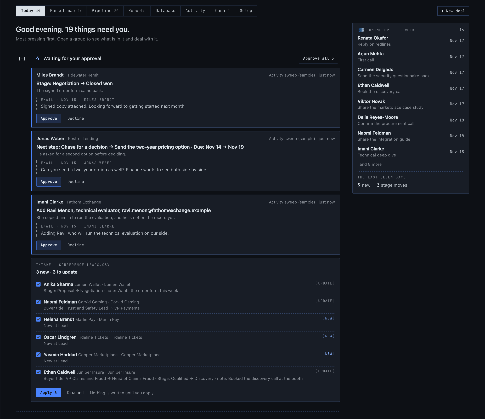

## The rest of the desk

- **Your call notes, wherever they are.** Plaud, Obsidian, Granola, Fireflies, or any recorder
  that saves a file. Point Stoa at the folder (or add a key), see at once which record each note
  is about, and Hermes files it there with the next step it implies.
- **Send it anything.** A PDF of leads, a spreadsheet, a photo of a sign-up sheet. Hermes reads
  it, Stoa shows what it would add and what it would change, and nothing is written until you
  press Apply.
- **Cash.** Invoices on a record, what is owed and overdue, won work that was never billed, a
  delivery lane after the win, clients billed by the month, and a forecast weighted by stage.
- **Talk to it on the page.** A talk box at the foot of the desk takes plain sentences and any
  file, runs on the model you pick for it, and folds away when you are done.
- **Drawn in the conversation.** Ask *"show me Dana"*, *"what needs me today?"* or *"how's our
  win rate?"* in a Hermes chat and the reply is the live card, the day or the report, with its
  buttons, not a description of it.
- **Slack.** Records post as cards whose buttons move the pipeline, and `!gtm` shows the board.
- **Three shapes, your stages.** A pipeline is for closing deals, filling roles or generating
  leads. You set its stages in your own words, up to seven, and one desk holds up to six
  pipelines side by side: your own sales beside the work you do for clients.
- **Searches, accounts and clients.** The group a record is in is a thing of its own: who the
  client is, its terms, and the people on the client's side.
- **Seven automations.** A morning brief, sweeps of your email, calls and notes, a weekly market
  watch, a Friday review, and a mirror to a Google Sheet. What they find waits for your approval.
- **Make it yours.** Type your business name under Setup and it is drawn in dots at the head of
  the desk, lit the way the stoa is.
- **Yours to keep.** One SQLite file on your machine, a daily copy, a CSV export, no telemetry
  and no Python dependencies.

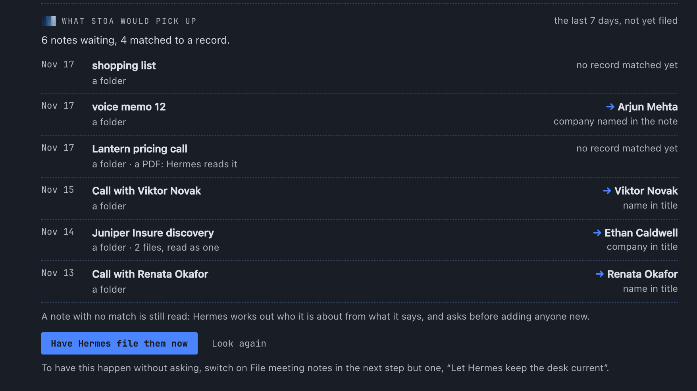

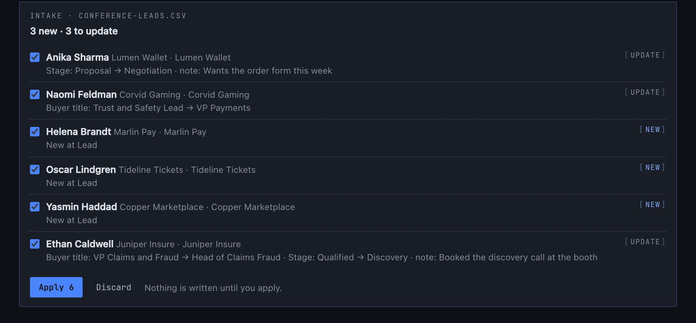

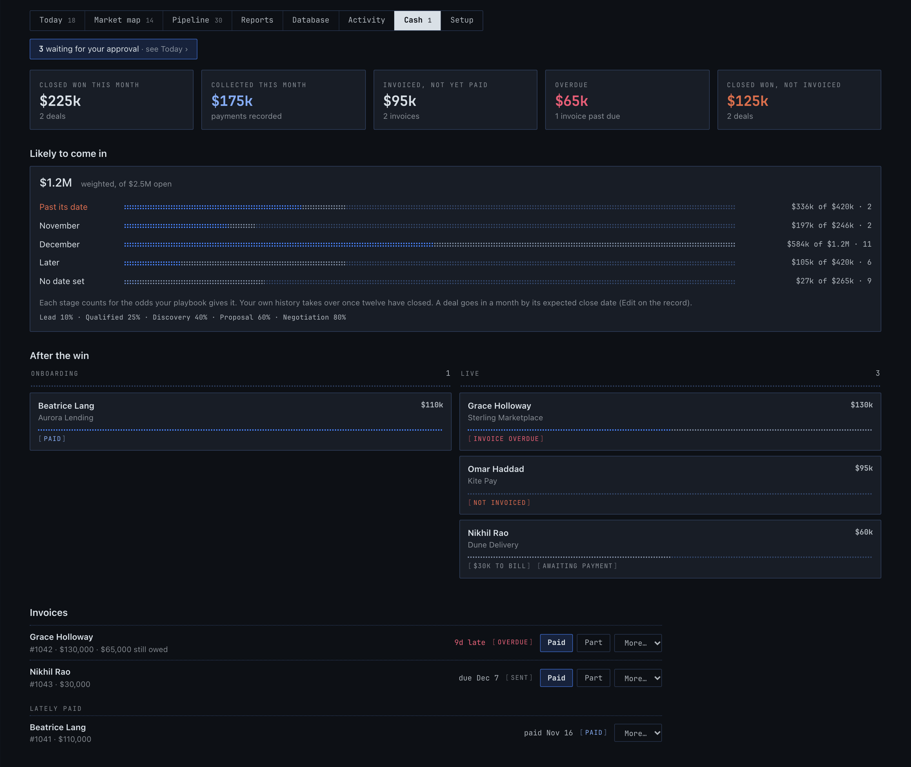

It grew out of a setup a recruiting agency runs its searches on every day, and the recruiting
shape is still first-class: candidates in searches, for clients, with fees and placements.

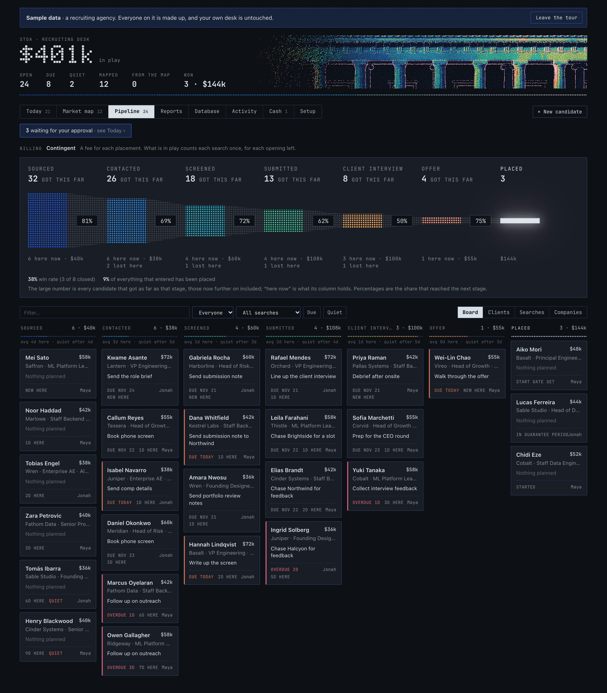

## Set up in five minutes

Stoa needs Hermes Agent 0.23.0 or later.

1. **Install it** in a terminal on the machine Hermes runs on, and restart the gateway so Hermes
   loads it:

   ```
   hermes plugins install jarrett-del/hermes-stoa
   hermes plugins enable stoa
   hermes gateway restart
   ```

2. **Switch on the page.** In the Desktop app or the Webapp, go to **Capabilities → Plugins**,
   switch **Stoa** on, and open **Stoa** in the sidebar. In a terminal or any chat, `/gtm` works
   straight away.
3. **Say what the desk is for.** Pick closing deals, filling roles or generating leads, and name
   your stages. Or take a tour of sample data first: it lives in a file of its own and never
   touches your desk.
4. **Put something on it.** Tell Hermes (*"We are starting a Staff Backend search for Northwind.
   Add Dana Whitfield, call her Friday."*), drop a spreadsheet of leads on the page, or say
   *"Map the market for us."*
5. **Make it do more, when you want to.** The **Setup** tab lists four optional steps, each with
   the way to do it one press away: keys for company search and enrichment, your call notes,
   Slack, and the scheduled jobs that keep the desk current.

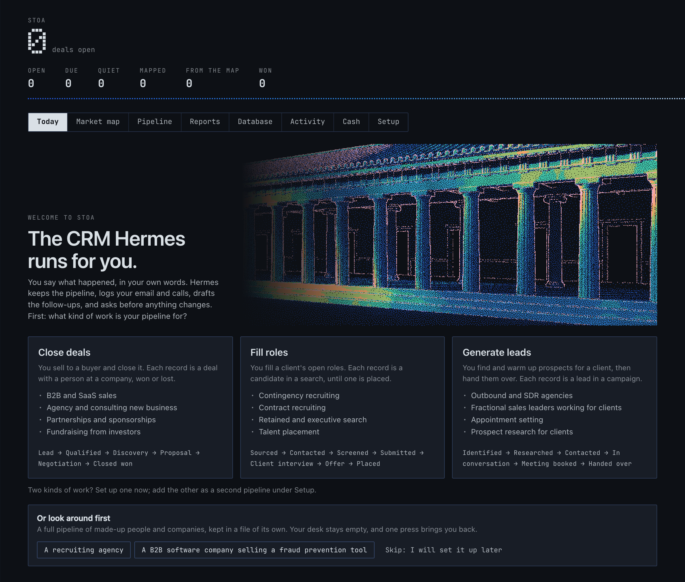

**[Setting up Stoa](docs/setup.md)** walks through every step with pictures.

`hermes plugins install stoa` installs from the Hermes plugin catalog instead. The catalog pins
a reviewed version, which can be behind this page. To look around without a desk of your own,
`hermes stoa demo saas` or `hermes stoa demo recruiting` loads a worked example, and
`hermes stoa demo --leave` puts it away.

In Slack the command is `!gtm` (Slack keeps the slash for its own commands), and
`!gtm Dana Whitfield` or `!gtm map` posts the card or the map itself, buttons included.

## Read more

- **[Setting up Stoa](docs/setup.md)**: one pass from install to keys, call notes, Slack and
  scheduled jobs.
- **[Using Stoa](docs/guide.md)**: a day on the desk, tab by tab, with two worked examples.
- **[What is in the plugin](docs/reference.md)**: the tools, market maps, intake, the pipeline,
  approvals and undo, reports, the database, cash, people, searches and accounts, playbooks, and
  every setting.
- **[The web dashboard tab](docs/dashboard.md)**.
- **[Limits](docs/limits.md)**: what it does not do yet.
- **[Development](docs/development.md)**: tests, and how it is put together.

## Disclosure

What the plugin does that you would want to know before installing it.

In short: it calls four outside services, each only once you add that service's key. It keeps your
records unencrypted in one SQLite file in Hermes's own plugin-data folder. It sends no telemetry.
It runs no shell commands and no background processes. The detail follows.

- **Network calls.** Only when you add the matching key, and only to four hosts:
  `api.peopledatalabs.com` (the name, email, LinkedIn URL or company of the one record being
  enriched, or a company name and job titles for a buyer lookup), `api.exa.ai` (the search
  phrase for a market-map search), `public-api.granola.ai` (reads your note list and note
  summaries; transcripts are never requested) and `api.fireflies.ai` (reads your recent meetings'
  titles, dates and attendees, and one meeting's summary and action items when it is read; the
  transcript, audio and video are never requested). No telemetry, no usage reporting, no other
  outbound requests. Research the agent does with its own web tools is Hermes's, not the plugin's.
  Pressing **Test** beside a key on the Setup page makes one small request to that key's service:
  a lookup for a made-up address at People Data Labs (it bills a match only, so this is free), one
  search for one result at Exa (billed like any search), the first page of your note list at Granola, or the id of one meeting at Fireflies.
- **Dictation.** The microphone in the page's dock uses your browser's own speech recognition,
  not anything of the plugin's or the agent's. In Chrome that means the audio goes to Google's
  speech service while you dictate. It listens only while the button is on, and the button is not
  shown where the browser has no speech recognition.
- **Paid lookups.** People Data Labs charges per person returned. **Find buyers** on the map asks
  for one person at each company picked that has nobody named, with a job title like the buyers
  already named on that map and a rank of manager or above as People Data Labs records it, so it
  spends at most one credit a company and saves nobody where no one of that rank matches. Every lookup counts against
  `pdl_monthly_cap`, and a buyer lookup returns at most five people.
  A map can carry a lower cap of its own, set under **Map facts**.
- **What a map has cost.** The plugin listens to two of Hermes's hooks, `post_api_request` and
  `post_llm_call`, and takes only counts from them: for a turn that worked on a market map, how many
  model calls it made, their token counts and seconds, and what Hermes itself estimates they cost
  (`agent.usage_pricing.estimate_usage_cost`, Hermes's own price list). No prompt, reply or tool
  result is read or kept. The totals are stored per map in the plugin's own database and shown under
  **Map facts**; they go nowhere else. The dollar figure is an estimate, not an invoice, and a model
  Hermes has no price for shows no figure. Turns on other work are not counted at all.
- **Slack.** Cards are posted and updated through the Slack app Hermes is already connected
  with. The plugin never reads, stores or sees the Slack token. A button moves a stage, applies a
  list and can spend a paid lookup, so a press is taken only from the person the card was posted
  for, or, when you list people in `slack_users`, only from them, and only in a chat the desk is
  available in. Anyone else gets a private "Not allowed" and nothing changes.
- **Credentials.** `PDL_API_KEY`, `EXA_API_KEY`, `GRANOLA_API_KEY` and `FIREFLIES_API_KEY` are read through Hermes's secret scope
  (`agent.secret_scope.get_secret`). The plugin reads no `.env` or credential file. A button click
  or a web-tab request arrives outside any chat turn; on a gateway serving several profiles the
  plugin then installs its own profile's scope around the read, the way Hermes does for its own
  background work (`set_secret_scope(build_profile_secret_scope(home))`), and removes it after.
- **Desktop app and Webapp.** `desktop/plugin.js` is one file with no build step. It imports only
  the Hermes plugin SDK and React and calls the plugin's own backend (`/api/plugins/stoa/`). After a
  click that calls for writing it sends one line into the open chat through `host.composer.submit`,
  the same as typing it. The dock on the page keeps one conversation of its own, named **Stoa
  desk**, and the market map keeps another for its research, named **Stoa map research**: each is created and resumed through the gateway (`host.request`: `session.create`,
  `session.resume`, `prompt.submit`; **New conversation** makes another, with the day and time
  in its name), it is sent only what you type or dictate there or what a button you press on the page asks for (with a short
  note of context on its first message and, on a desk with more than one pipeline, a line saying
  which pipeline the page is showing; both can be read in that conversation), and the page listens
  to the gateway's events for those two conversations alone to show you the reply. The model pickers (under the dock, and **Research:** on the market map) ask Hermes for the models this profile can
  use (`model.options`) and set the one you pick on that conversation alone (`config.set` with
  `--session`, the call the app's own picker makes); the pick is kept in the plugin's page storage
  on that computer, and the profile's default model is never changed. A file is read only
  when you pick it or drop it on the page: a CSV's text goes to the plugin's backend to be held as a
  review; a small text file goes to the agent inside your message; and any other file (a PDF, a Word
  file, a picture, up to 25 MB) is handed to Hermes with your next message through the gateway's own
  attach calls, the ones the app's chat box uses (`file.attach` for a file, `image.attach_bytes` for
  a picture), so it is Hermes that stores and reads it: Hermes keeps its own copy in the profile's
  home folder, in `attachments/` (a picture in `images/`), and nothing of Hermes's clears those two
  folders. So the page tells the plugin's backend the path Hermes gave back, the plugin keeps a list
  of those copies (`handed-files.json` in its data folder: paths, names and sizes, no contents), and
  it removes each after seven days, or the number you set under **Setup → Your data**
  (`files_keep_days`; 0 keeps them until you press **Remove them now** there). The tidy-up runs once
  a day, the first time the desk is opened, like the daily copy. The model
  menu is the app's own (`ModelCatalogMenu`), and a thinking level picked in it is set on that
  conversation with `config.set reasoning`. The picture at the head of the page is drawn in the browser from a grid of
  dots that ships with the plugin (`desktop/art.json`), and a name you type under Setup is kept in the
  plugin's own database (with whether the two are in color, in one ink, or follow the theme) and drawn the same way; neither is sent anywhere. It does not touch the app's
  DOM or other plugins' storage, and it checks in with the backend every 30 seconds while open so
  the agent knows a card can be drawn in the conversation.
- **Web dashboard.** The tab is set-up and status only: it shows what is set up and the desk in
  totals (counts, and the names of pipelines and maps; no person or company), and it has no pipeline
  board or map. It calls only the plugin's own routes under `/api/plugins/stoa/`, behind the
  dashboard's own sign-in: it reads the set-up and the totals, checks and saves the notes folder,
  saves what a scheduled job may change, ends a tour, and hands the pipeline to your browser as a
  CSV download when you press Export. It has no box for a key and makes no call to the dashboard's
  key store: **Open Keys** takes you to the dashboard's own Keys page. Those routes are shared with
  the page in the Desktop app and Webapp, which is what reads and changes the pipeline. They call no
  model and no outside service, except **Test** beside a key (above) and the paid lookups described
  above.
- **Reports.** Every figure on the Reports tab is counted by the plugin from its own database: no
  model is called to make one and nothing is sent anywhere. The reports you make, and which are on
  the dashboard, are kept per pipeline in that pipeline's file. Three presses on the tab send words
  to Hermes, in the talk box where you can read them: **Ask for a report** and **Change it in
  words** send what you typed, and **Ask Hermes about it** asks the agent to read that report, so
  its figures (counts and totals by stage, source, owner and so on; no list of people) go to the
  model you have picked. A report Hermes makes is a draft until you keep it, and a scheduled job
  cannot add or remove one. A report saved as a page is one file with no script that asks nothing
  of the network; it carries figures and the names of sources, owners, stages and groups, and names
  no record. A row saved as a spreadsheet does list its records.
- **The database.** The tables on the Database tab are worked out by the plugin from its own
  database each time the tab is opened: no model is called and nothing is sent anywhere. The views
  you save are kept in that pipeline's file, up to 40. A change made in a cell or to ticked rows
  goes through the same routes as the record's own page, so it is logged on the record and can be
  taken back. **Copy emails** puts the addresses of the rows shown on your clipboard, and **Export
  CSV** hands the rows shown to your browser as a download; neither goes anywhere else.
- **The Setup tab.** It shows, to anyone signed in to your Hermes, which chats and Slack members
  the desk is limited to, the folders it reads and writes, where its database file is, and whether
  each key is set. It never shows a key or a token.
  **Add key** and **Change key** open Hermes's own settings page for the plugin, which is where a
  key is typed and saved; Stoa's page has no box for one.
- **Sample data.** A tour writes two things in the plugin's own data folder: `tour.json`, which
  says a tour is on, and one `tour-<id>.db` holding the made-up records. Both are deleted when
  you leave. While they are there the plugin does not read or write your own `desk.db`, apart
  from counting what is in it for the Setup tab.
- **Files outside the plugin's own data.** It reads call notes in the folders you set as
  `notes_dir` (up to eight), each and up to three folders below it: Markdown, text, Word (`.docx`),
  subtitle (`.srt`, `.vtt`), web-page and rich-text files. Listing the notes waiting (on a sweep,
  or when you press **See what is waiting** on Setup) opens the first part of each to see which
  record it names; the rest is read when the agent reads that note. A PDF there is not opened by
  the plugin: its path is given to the agent, which reads it with its own tools. Recordings are
  counted and never opened. By path it reads only `.csv` and `.tsv` files, and only from the plugin's
  own `imports/` folder, the folder you name in `import_dir`, and the working directory when that
  is a project folder; a path passed to Stoa's tools from anywhere else is refused. (At a terminal,
  `hermes stoa import <file>` reads any CSV it is given, and takes it as a list of past records, whose
  placements keep their fees on contract work too. Nothing checks who typed it: an agent that has a
  terminal can run it as well.) It writes nowhere outside its own data
  folder: exports (the pipeline as CSV, a market map as a web page) always go to its `exports/`
  folder, and a file name is all the agent can choose.
  On the Setup page, **Check** counts the note files in a folder you name, and **Look for a folder**
  does the same for a short fixed list of usual places (`~/Documents/Meeting notes`,
  `~/Documents/Meetings`, `~/Documents/Call notes`, `~/Documents/Notes`, `~/Documents/Plaud`,
  `~/Plaud`, `~/Documents/Transcripts`, `~/Documents/Obsidian`, `~/Obsidian`, the iCloud Obsidian
  folder, `~/Documents/Granola`, `~/Notes`), only when you press it. Neither opens a note.
  **Add folder** there stores the folder in the plugin's own `notes_dir` setting, the way Hermes
  saves any plugin setting.
- **Notes in a connector of Hermes's own.** If you list a connector under `notes_connections`
  (for example Plaud's), the plugin does not contact it and holds no access to it. The notes inbox
  tells the agent that notes live there; the agent reads them with that connector's own tools and
  files a short summary on the desk. The plugin stores only the id the agent gives each note, so
  none is filed twice.
- **Hermes's scheduled jobs.** To show which of its automations are switched on, Setup reads the
  name, schedule and on-or-off state of this profile's scheduled jobs. It changes none of them.
- **Messages to the agent.** With `allow_gateway_injection` granted, a button click queues one
  instruction for the agent in the card's thread. The agent drafts; it is told not to send.
- **Stored data.** Names, emails, notes and enrichment results for the people in your pipeline,
  the other people you add to a record or to a search or account (the client's side), what you
  keep on a search or account itself (its client, its terms, its notes), and the invoices and
  payments you record (amounts, numbers and dates; no bank or card details, which Stoa never asks
  for) sit unencrypted in `plugin-data/stoa/desk.db`. Each further pipeline you open has a file of
  its own beside it (`pipe-p2.db` and so on), and `pipelines.json` names them.
- **Daily copies.** Once a day, the first time the desk is opened, a copy of that file is written
  beside it in `plugin-data/stoa/backups/` and the fourteen newest are kept. They are as
  unencrypted as the file itself, and they are on the same disk: they guard against a mistake, not
  against losing the machine.
  Every change is kept on a ledger in that file with the values before and after it, and the
  ledger is never trimmed; a record or a person taken off the desk is archived there, not erased;
  what you declined is kept for 90 days; evidence quoted in a proposal is kept with it. To erase
  someone for good, delete the file or edit it with a SQLite tool. Treat it like the customer
  list it is.
- **What runs without you.** A scheduled job reaches the desk only if you list `cron` in
  `channels`, and then changes only what the autonomy setting allows; the rest is held for you.
- **The only files it deletes outside its own data folder** are those copies: a file is removed
  only if it is on that list, is a plain file directly in this profile's `attachments/` or `images/`
  folder, and is still the size and age it was when Hermes handed back its path. A file from another
  chat is never on the list; one that has changed since is left alone and marked. Your own file,
  where you had it, is never touched.
- **No shell commands, no background processes, no self-updates, no Python dependencies.**

## License

MIT
