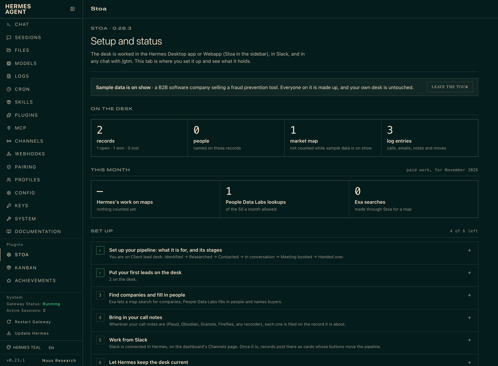

# The web dashboard tab

Stoa adds a tab to the Hermes web dashboard (`hermes dashboard`). It is for setting Stoa up and
seeing what the desk holds. It does not show the pipeline or the market map: the desk itself is
worked in the Hermes Desktop app or Webapp (Stoa in the sidebar), in Slack, and in any chat with
`/gtm`. If the dashboard was already running when you installed Stoa, restart it once and the tab
appears.

From the top of the page down:

- **On the desk.** Records (open, won, lost), people named on them, market maps with how many
  companies are mapped and how many of those are in the pipeline, and log entries. With more than
  one pipeline these are the totals across all of them.
- **This month.** Paid work: Hermes's own estimate of what its work on your maps cost (not an
  invoice), People Data Labs lookups against the monthly cap, and Exa searches made through Stoa.
- **Set up.** The same six steps as the Setup tab on the Stoa page, each showing where it stands.
  Press one and it opens onto how to do it from the dashboard:
  - *Keys.* Each key says what it adds, what it costs and how to get one. **Open Keys** goes to
    the dashboard's own Keys page; add the key under **Custom Keys** with the name the step gives
    (`EXA_API_KEY`, `PDL_API_KEY`, `GRANOLA_API_KEY`). Back on the tab, **Test** has the service
    confirm it. No key is ever typed into Stoa's tab.
  - *Call notes.* Paste the folder your notes are saved in, **Check** it, **Save** it. **Look
    for a folder** tries a few usual places.
  - *Slack.* **Open Channels** goes to the dashboard's page for messaging platforms.
  - *Scheduled jobs.* Which of Stoa's seven jobs are on, with when each runs next, and what a
    scheduled job may change without asking. **Open Cron** goes to the dashboard's own page for
    pausing, changing or removing one. Switching one on is done in a chat, with `/blueprint`.
- **Pipelines.** One row each: its stages, how many records are open, won and lost, its file and
  size, and how many daily copies there are.
- **Market maps.** One row each: companies, how many are in the pipeline, buyers named, what
  Hermes's work on it has cost in all and this month, paid lookups and searches, and the limits set
  on it. Limits are set on the Stoa page, under **Map facts**.
- **Rules in force.** Where the desk answers, who may press a Slack button, what a scheduled job
  may change, which folders Stoa reads and writes.
- **Your data.** Where the files are, the daily copies, the ledger, and **Export the pipeline as
  CSV**. If sample data is on show, **Leave the tour** is here.

The tab takes its colours, type, square corners and hairlines from the dashboard's theme, so it
reads as one of its pages in whichever theme you run. It checks again every fifteen seconds.

Before 0.22 this tab showed a copy of the pipeline board, the market map and the activity log. It no
longer does. Those are on the Stoa page in the Desktop app and the Webapp.
