# Using Stoa

How the desk works day to day, tab by tab. To get it installed, see [Setting up Stoa](setup.md).
For everything in the plugin, tool by tool, see [the reference](reference.md); for what it does
not do yet, [the limits](limits.md).

**On this page:** [Any pipeline](#any-pipeline-and-two-worked-examples) · [Today](#today) ·
[GTM](#gtm) · [Pipeline](#pipeline) · [A record's page](#a-records-page) ·
[Dashboard](#dashboard) · [Data](#data) · [Production](#production) · [Setup](#setup) ·
[Talking to the desk](#talking-to-the-desk) · [In a Hermes chat](#in-a-hermes-chat) ·
[In Slack](#in-slack)

## Any pipeline, and two worked examples

A pipeline has one of three shapes, named for how the work moves:

| | Close deals | Fill roles | Generate leads |
|---|---|---|---|
| **For** | B2B and SaaS sales, agency and consulting new business, partnerships, fundraising | Contingency and contract recruiting, retained and executive search | Outbound and SDR agencies, fractional sales leaders working for clients, appointment setting |
| **A record is** | a deal with a person at a company | a candidate in a search, for a client | a lead in a campaign, for a client |
| **Billed** | when a deal is won, or monthly on the account | on placement, or monthly on the client | monthly on the client; a lead is never invoiced |

The first time you open the page you pick one, then set its stages in your own words: rename them,
put them in your order, add or take away (two to seven), and say what a win and a loss are called.
Not sure? Describe your business and Hermes sets the stages for you.

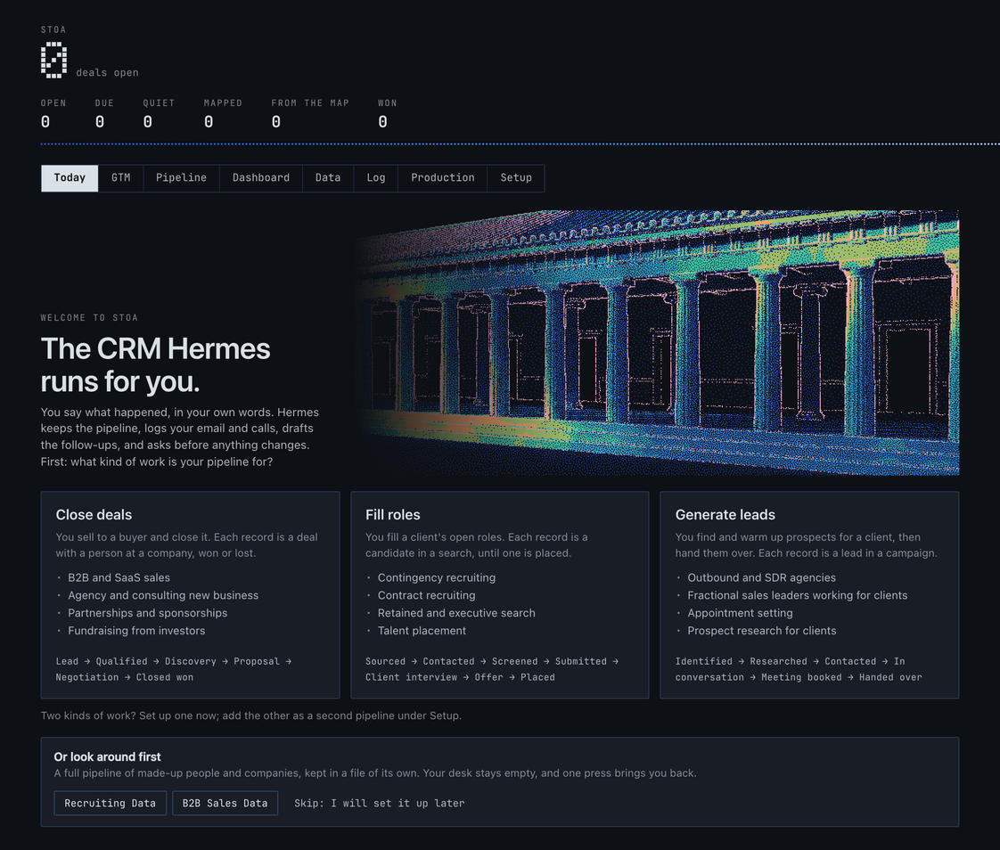

**Setup → Edit stages** changes them later, and **+ Pipeline** opens another pipeline the same
way: contract work beside contingency, your own sales beside the leads you find for clients. One
desk holds up to six, and two pipelines of the same shape can each have their own stages.

Underneath, each shape runs on a playbook (`b2b-sales`, `recruiting`, `client-leads`; `agency` and
`partnerships` still ship for desks that use them), and a pipeline whose stages you changed gets
its own copy. Hermes can write a whole playbook from a short conversation when you want more than
stages.

The sample data shows two businesses at a realistic size. Everything in it is made up.

| | A recruiting agency | A B2B software company selling a fraud prevention tool |
|---|---|---|
| **Tour it** | `hermes stoa demo recruiting` | `hermes stoa demo saas` |
| **A record is** | a candidate in a client's search | a deal with a buyer at an account |
| **Stages** | Sourced → Contacted → Screened → Submitted → Client interview → Offer → Placed | Lead → Qualified → Discovery → Proposal → Negotiation → Closed won |
| **On the desk** | 24 open candidates across 8 searches, **$401k** in play (each search's fee counted once), plus 3 placed and 5 passed | 28 open deals, **$2.5M**, plus 4 won and 6 lost |
| **Its market map** | A candidate map for one search: 12 people in three pools, each with their own fit and reason to move, and adding one makes them a candidate in that search | Fintechs and marketplaces exposed to payment fraud: 14 companies, what each uses today, and who to call first |

A tour never touches your own desk. The sample data lives in a file of its own, with its own
playbook; every surface says it is sample data while it is on show; lookups are off and scheduled
jobs wait. **Leave the tour** on the page, or `hermes stoa demo --leave`, brings your desk back
exactly as it was and throws the sample file away.

The recruiting agency:

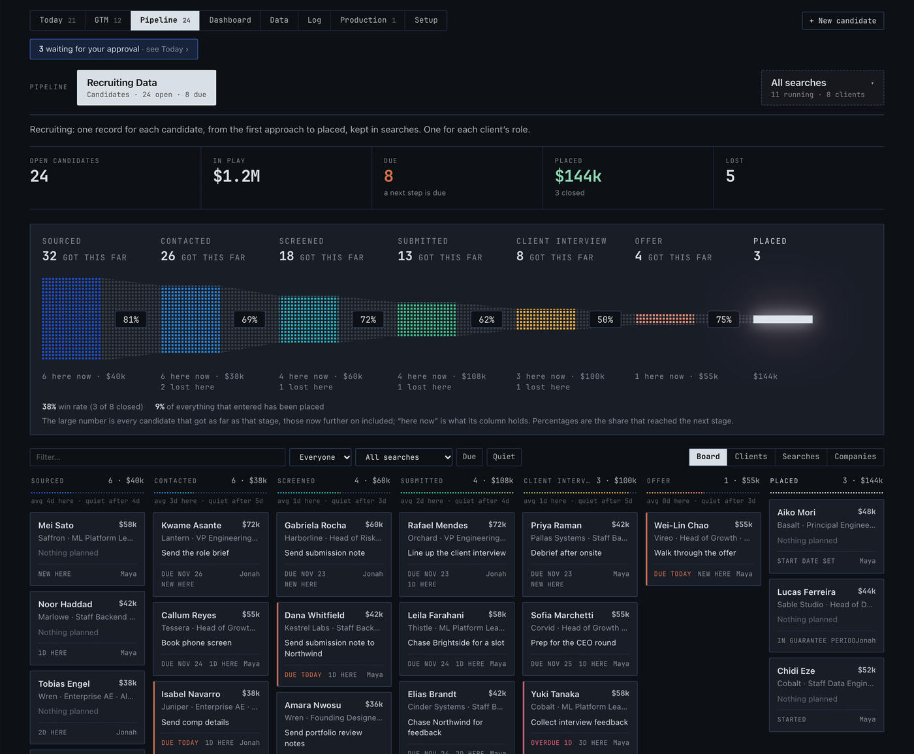

The company selling a fraud prevention tool:

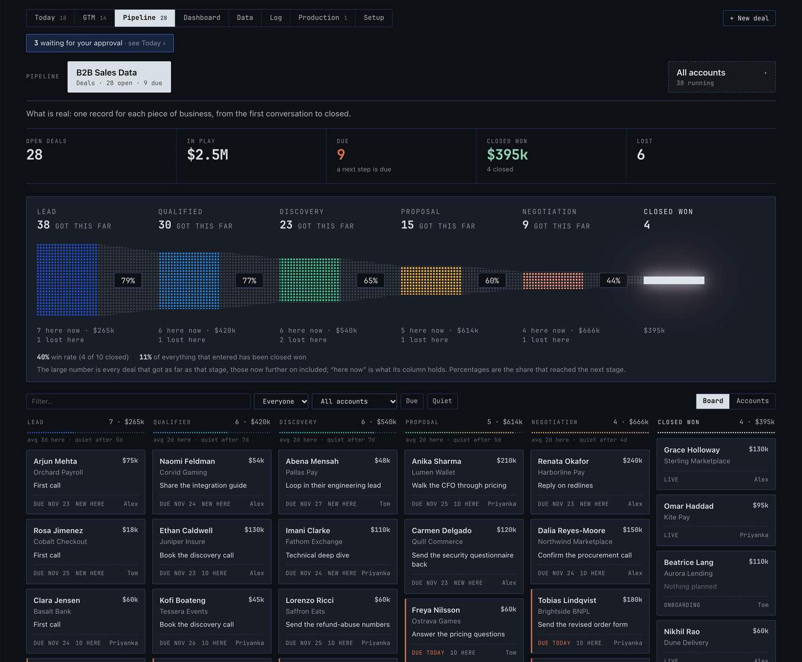

## The page

**Stoa** in the sidebar of the Hermes Desktop app and the Webapp opens the desk. Across the top:
what is in play, in figures. Under it, the tabs: **Today**, **GTM**, **Pipeline**,
**Dashboard**, **Data**, **Log**, **Production** and **Setup**. At the foot of every tab, a box
to [talk to the desk](#talking-to-the-desk).

Every colour comes from the app's own theme, so the page looks like part of Hermes in whatever
theme you run. Any text on it (a name, an email, a note, a next step) can be selected and copied.

### Today

What needs you, most pressing first: what is waiting for your approval, next steps overdue and
due today, invoices gone late, wins nobody has billed, records gone quiet, new ones with nothing
planned, and wins in delivery with no next step. Each kind is a group that opens. Closed, it is
one line that says how many and who; open, each row has one move, and the page remembers which
groups you left open.

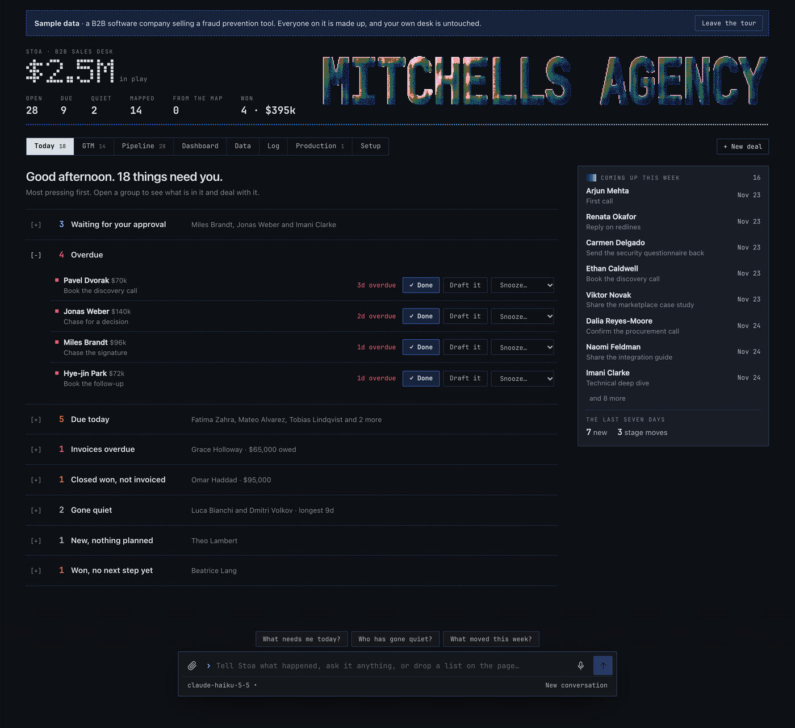

**Done** logs the step and asks what comes next. **Draft it** has Hermes write what the step
needs. **Snooze** puts it aside for a few days or until a date you pick, and until then it is on
no list. What is coming up this week sits beside it.

**Approvals.** Whatever Hermes suggests on its own is the first group on Today, one card each:
what would change, why, and what it rests on (the email, the call, in their words). **Approve**
writes it. **Decline** leaves the desk as it is, and the same suggestion is not made again. A list
you were sent is reviewed there too, as a whole.

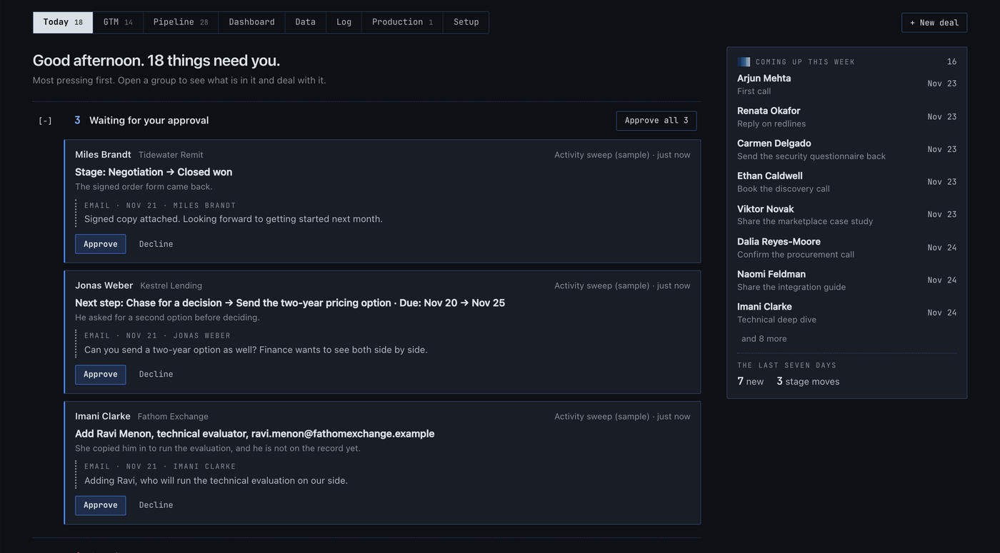

**Undo.** Every change records what it replaced. After anything you do, **Undo** appears above
the box at the foot of the page. A record's log and the Log tab offer it for the last change
on each record, whoever made it: you, Hermes or a button in Slack.

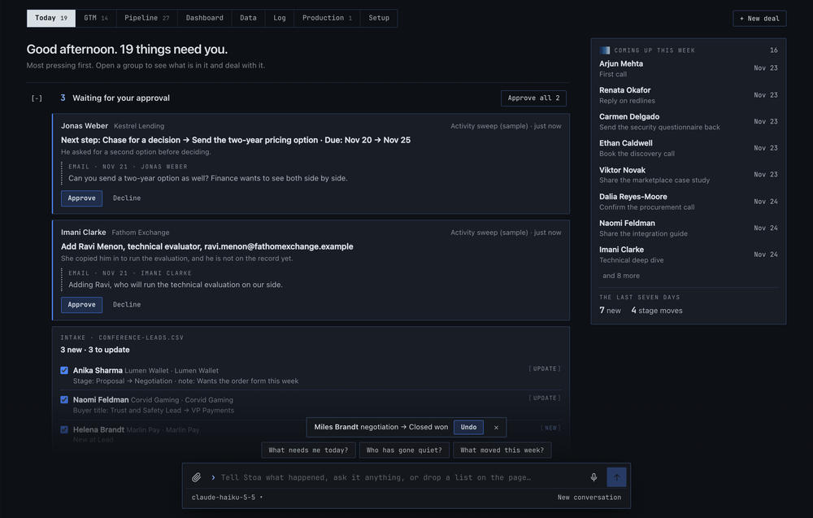

### GTM

How you sell, in three views: **Maps**, **Motions** and **Assets**. Pin the one you want the tab
to open on with the pin at the right.

**Maps.** Ask Hermes to map a market (*"We sell a fraud prevention tool to fintechs and
marketplaces. Who should we go after?"*) and the map appears here when it is saved. Its head is
one row of controls (the map's own menu, **Research:**, **Map facts**, the downloads) and its
numbers. Under them, three columns read the map back:

- **Where we play.** The map's brief (what you sell and who to, printed on the map when it is
  shared), your internal notes (never printed or sent; Hermes works from them and is told not to
  quote them), and each segment with how many to call now and its average fit.
- **How we win.** What the map means, who you would be replacing (press one to light those
  companies up), and the motions aimed at this map.
- **What has to be true.** Each requirement and how many companies show it. Press one to light
  them up.

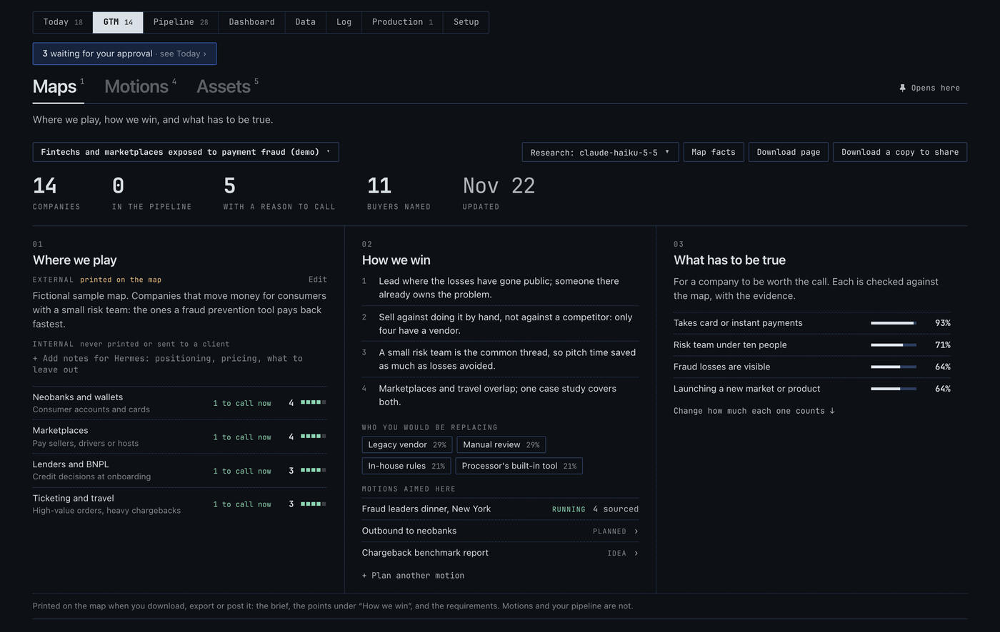

The map itself is a dial. Each slice is a segment (or, under **Held by**, what the companies use
today), and the nearer the centre, the sooner to call: **Call now**, **Line up**, **Watch**. A
mark's colour is fit, a solid mark is in the pipeline, a ring is a reason to call, a dashed mark
is new since you last looked. When nobody is in the centre yet, the dial says why and offers to
have Hermes look for reasons to call at the best fits.

- **Open one.** Click a company and its panel opens beside the map: why it fits, each requirement
  with its evidence, the facts, the buyer and the source.
- **Pick several.** Shift-click or drag across the dial. Then add them to the pipeline, name a
  buyer at each, have Hermes draft outreach, find more like them, or dismiss them.
- **Grow it.** **+ Grow** under a segment, **More like these** on what you picked, or **+ A
  neighbouring segment**.
- **Adjust it.** Under **What matters**, set each requirement to Off, Nice, Matters or Must and
  fit is worked out again from your weights.
- **Filter it.** The quick filters above the dial light up the companies they describe.

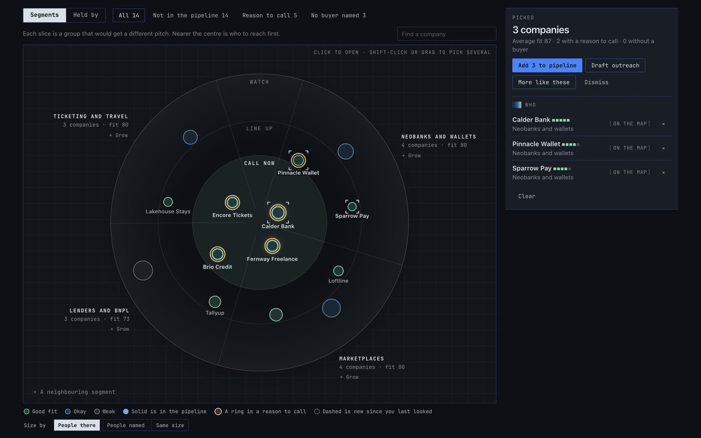

**Managing your maps.** The map's name is a menu: switch maps, start a **New map**, **Rename**,
**Archive** (out of every list, Hermes's included, with everything on it kept; archived maps are
listed at the foot of the tab to put back or delete for good) or **Delete**. **Research:** is the
model Hermes researches maps with, in a conversation of its own. **Map facts** shows how complete
the map is, where it came from, what Hermes's work on it has cost, and the limits you set.
**Download page** saves the map as one web page; **Download a copy to share** leaves out buyers'
names and your pipeline.

**Motions.** The plays that carry the go-to-market, grouped by where they stand: running,
planned, ideas and finished. **+ New motion** takes a name, a kind (outbound, event, ads,
content, partnership, referral, community), the map and segments it is for, dates, a budget
and words to watch for. **Suggest motions** has Hermes read the map and propose three as ideas.

**Who a motion is run on** is its list. Pick companies on the map and press **Add to motion**:
each is added to the pipeline as a lead (in your lead pipeline, if you have one) and put on the
list. On the motion's page, add a record from any pipeline by name, or **New lead** for someone
found elsewhere ("Name, Company"). A record's own page shows the motions it is on and puts it on
another. Each on the list is added, reached, replied or meeting: a call or email logged on it
counts as reached, and a meeting as a meeting, without anyone saying so.

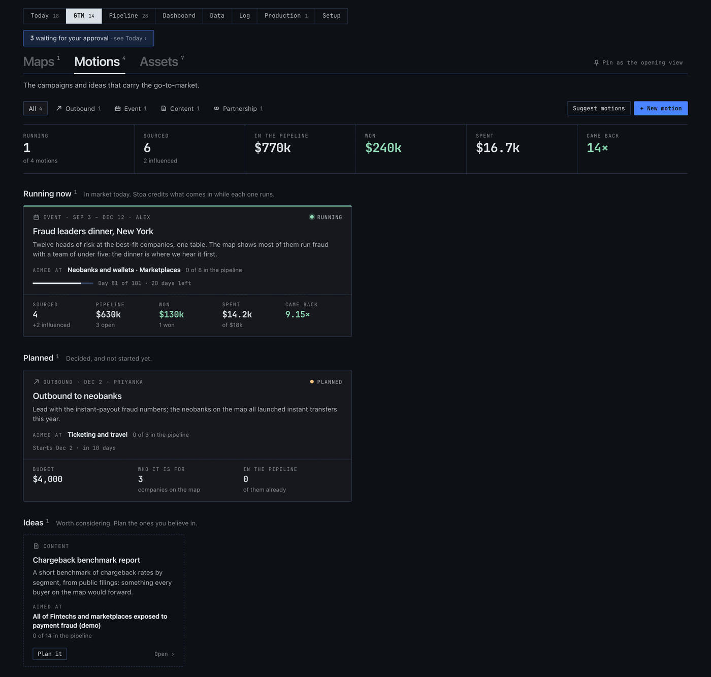

Stoa credits a motion by itself, across every pipeline, and gives the reason each time: one the
list brought into the pipeline (from the map, or as a new lead) was sourced by it, and one that
was already in a pipeline was influenced; a record off the list whose Source or notes mention the
motion counts too. What it won counts everyone on its list, new or not. Being at a company on
the map is not enough. A deal handed over from a
credited lead is credited too, and the two count once. Open a motion to confirm a record, set one
aside, and log what it spent, reached, and the responses and meetings it got.

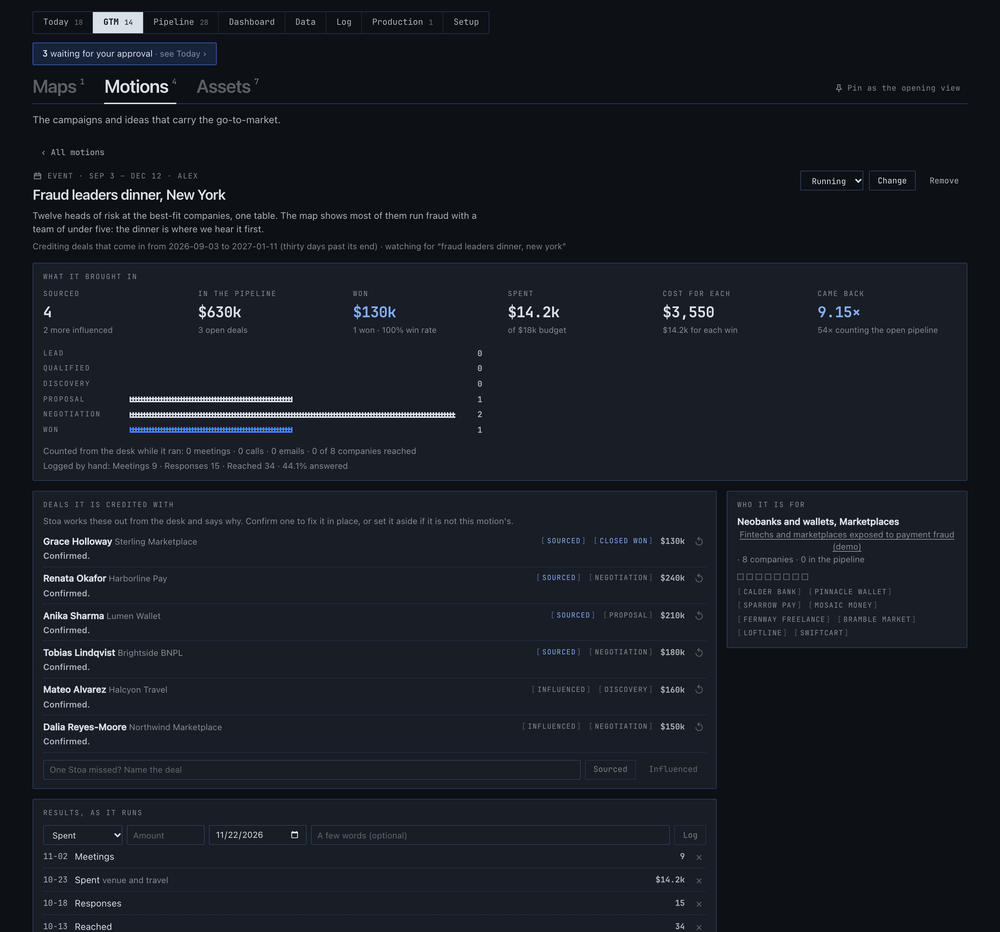

**Assets.** The pitch deck, one-pagers, case studies and pricing, each a file kept with the desk
(drop it on the list) or a link to where it lives, and the links worth having to hand. Hermes
reads the list, so what it drafts points at the real thing; it never reads or sends a file.

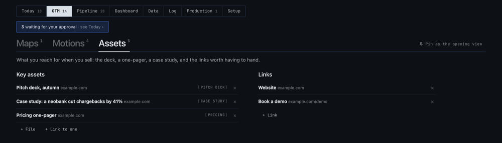

**Adding a company to the pipeline.** On a pipeline of deals the new record is named for the
company, with the buyer as a person on it. On a pipeline of roles or leads the record is the
person. A company that already has an open record is filled in from the map (the buyer, the
evidence) and not added a second time.

### Pipeline

Every pipeline at the head, then a funnel over a board.

**Every pipeline at once.** The pipelines on the desk sit in a row at the head of the tab (more
than four fold into one list), each with what it holds and how many are open; press one to show
it. Beside them is the picker for its searches, accounts or projects, with **+ New** at its foot.
Under them, the figures of the pipeline showing, or of the one search it is narrowed to. **+ New
pipeline** adds a lead, deal or recruiting pipeline.

**Lead pipelines hand over.** A lead pipeline's figures end with where it hands over: *At
"Handed over", opens a deal in* a deal pipeline you choose (the first one, unless you say, or
nowhere). When a lead is closed there, by anyone or anything, a deal opens in that pipeline named
for the company, with the lead as a person on it, the lead's notes and where it came from. A
second lead at a company that already has an open deal there joins that deal. Both records say
where the other is, and Hermes can do the same with `gtm_playbook` (`set_handover`, `hand_over`).


**The funnel.** The large number over each stage is every record that got that far, those now
further on included. The small one is how many are in that stage now. The percentages between
are the share that went on to the next stage. Press a stage to pick out its column on the board.

**The board.** One column a stage. Drag a card to another column to move it. Narrow the board by
any text, by owner, by search or account, to what is due or what has gone quiet. **Accounts** (or
**Searches**, **Clients**, **Companies**, in your playbook's words) lists the groups beside the
board.

**A card** shows the contact (or the company and group), the next step in full, and a row along
its foot: when the step is due or how far overdue, how long the record has been in its stage,
whether it has gone quiet, how many people are on it, and the owner. A card that is overdue or
due today has a coloured edge.

**Rest the pointer on a card** and, after a moment, a panel opens beside it: the stage and time
in it, the next step, the people, the notes, and the last three things logged. It goes when the
pointer does.

**+ New** adds a record from a short form, with a **Source** box that suggests the sources already
in use.

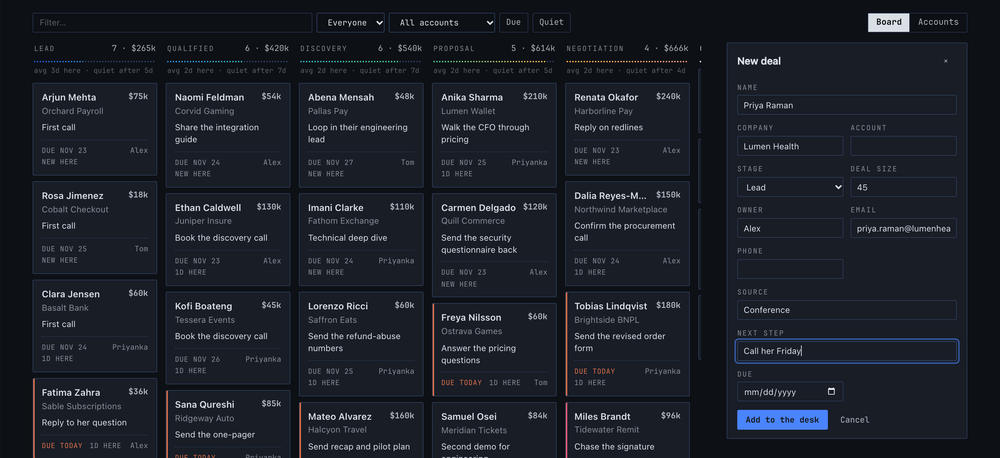

**A page for each search, account or client.** Its details and notes, its records a stage at a
time, the people on its side, and what happened lately. **+ New ... here** adds a record to it.
Where an account or a client *is* the company (the B2B and agency playbooks), the company's email
domain and everyone at it are on the same page. Where a group is a piece of work (a search, a
campaign), a record's company has a page of its own as well.

**Clients, and billing by the month.** Where a search or a campaign is done *for* a client
(recruiting, lead searches), **Clients** lists them, and every "for Fernway" opens the client's
page: its searches, the candidates in them, who is on their side, and how it is billed. Contract
hours or a retainer are set up there (**Billing → Set terms**); each month that ends is then
waiting on **Today** to record as an invoice with the real hours, or to skip.

### A record's page

Press a record anywhere (Today, the board, Data, Production, Log) and it opens on a page of
its own, laid out the way a CRM is read.

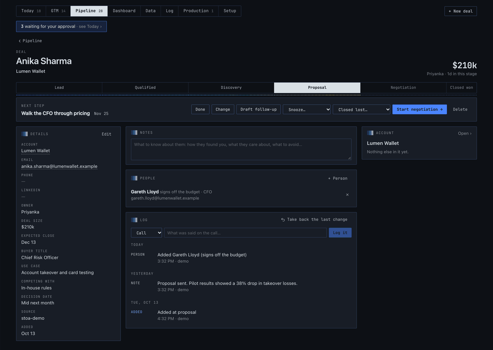

- **Across the top:** its name, where it sits (at its company, in its search or account), its
  value and owner, and the stages as one bar. Press a stage to move it there.
- **The next step**, with the moves for it: **Done**, **Change**, **Draft follow-up**, **Snooze**,
  close it, or advance it.
- **Details** on the left: every fact, the empty ones shown so you can see what is not known yet.
  **Edit** changes any of them, the playbook's own included.
- **Notes**, **People** and **Activity** in the middle. A record has its own person and can carry
  the others around it: the buyer's boss, finance, a hiring manager. Their email and calls are
  then filed on that record too. A line at the top of Activity logs a call, an email, a meeting
  or a note.
- **On the right:** the search or account it is in and the others there, others at the same
  company, and its money once there is any.

**After the win.** A won record moves along the delivery lane your playbook names (Onboarding →
Live, say). Until it reaches the last of those stages it keeps a next step that comes due like
any other, and winning it asks for the first one.

### Dashboard

The desk added up, counted by Stoa from your records with no model involved.

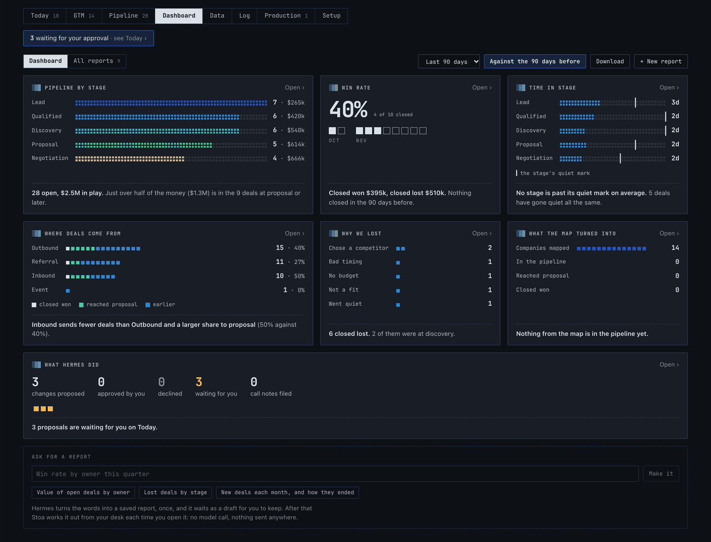

The **dashboard** shows the reports you have pinned, each with one sentence on what its figures
say. The period and **Against the … before** apply to every report that has a period. **Open** a
report to see it large: press a bar and the records behind it are listed. **Table** shows the
same rows as numbers, **Over time** the same records month by month, and **Download** saves it as
a page or a spreadsheet.

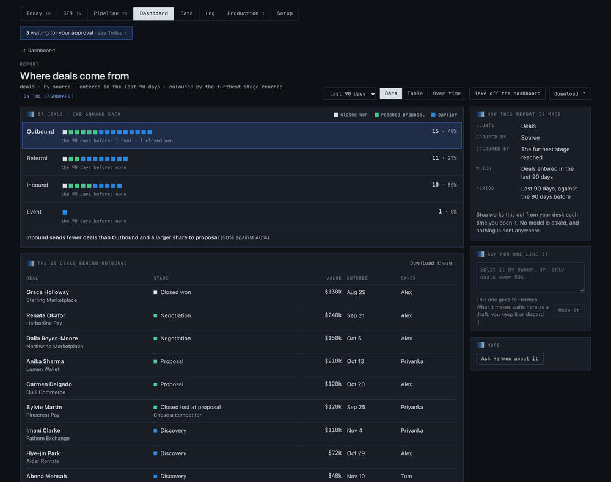

**+ New report** makes one from a few choices, on the page. Or type what you want into **Ask for
a report** (*"win rate by owner this quarter"*) and Hermes saves it as a draft for you to keep or
discard. [The reference](reference.md#reports) lists every report and what each figure rests on.

### Data

Everything the desk keeps, as a table to look through. Three lists: **Accounts** (every company
with a record, and every company on a market map), **Deals** (every record, open, won or lost)
and **People** (each person once, however many records they are on).

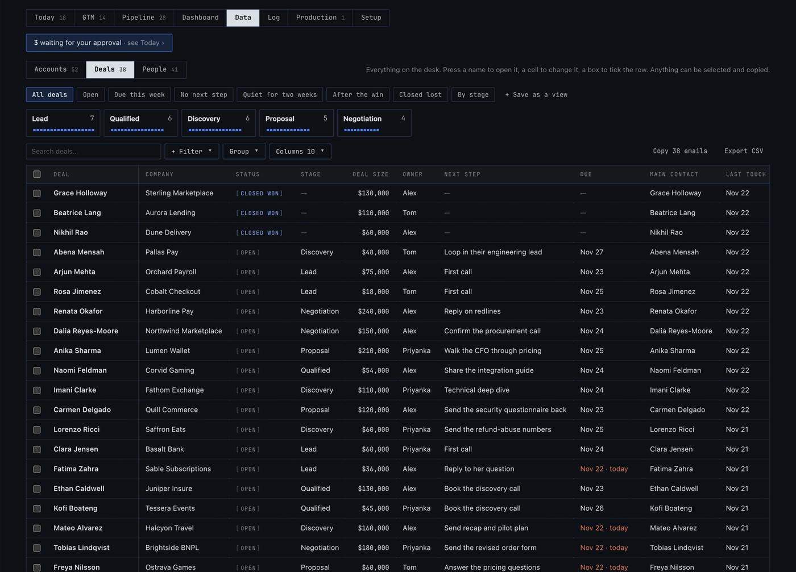

- **Look.** Search it. Press **+ Filter** to show only the rows where a column is, contains or is
  past something. Press a heading to sort. **Group** puts the rows under a heading for each value,
  with a count and a sum. **Columns** chooses what each row shows.
- **Count.** The boxes above the table count the rows by stage (or status, or company). Press one
  to see only those.
- **Keep a view.** A handful come with it (*Open*, *Due this week*, *No next step*, *Quiet for two
  weeks*, *After the win*, *Customers*, *On a map, not in the pipeline*). **Save as a view** keeps
  the filters, sort and columns in front of you as a view of your own.
- **Change a cell where it is.** Press an owner, a deal size, a next step and its date, a stage, a
  person's title or email, an account's website. Enter saves, Escape leaves it. Each change is
  logged on its record with **Undo** offered, as if made on the record's own page. A cell worked
  out from other things (a status, a count, a last touch) is not changed here.
- **Change many at once.** Tick rows (Shift ticks a run of them) and a bar offers the same change
  for all of them: set the owner, move to a stage, set the next step, the source or the expected
  close, or close them as lost.
- **Take it with you.** **Copy emails** and **Export CSV** take the ticked rows, or every row
  shown when none is.

**Accounts** counts open deals, value and people for each company, and holds the companies that
are only on a map so far. Tick those and **Add to the pipeline**.

**People** is each person once, with their title, company, email and the records they are on.

### Production

The other half of lead to cash. Five figures across the top: won this month, collected this
month, invoiced and not yet paid, overdue, and won but never invoiced. Beneath them, what the
open pipeline is likely to bring in, weighted by stage and laid out by expected close date; where
each won piece of work stands; and every open invoice with **Paid** and **Part** beside it.

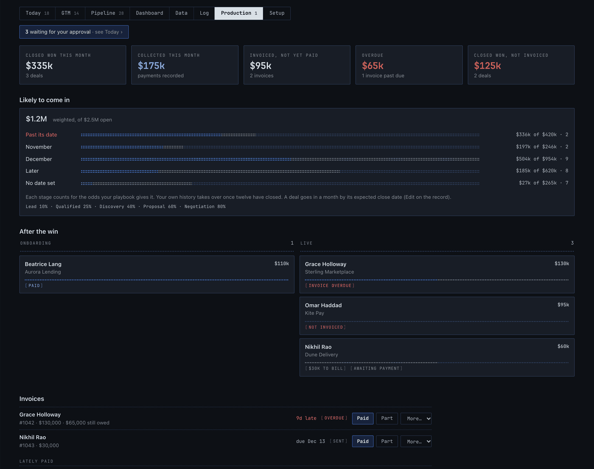

A record's **Money** section holds its invoices: the amount, the number, when it is due, what has
come in. Stoa does not send invoices or take payments. It keeps the account, so it can tell you
what is late and what you forgot to bill.

### Setup

One short list. **The two it needs**: say what the desk is for, and put your first record on it.
**Make it do more**, each optional: keys for company search and enrichment, your call notes,
Slack, and the scheduled jobs. Under **Your desk**: the name on the page, your pipelines, the
rules in force, your data with a CSV export, and a cheat sheet of things to say, press and type.
[Setting up Stoa](setup.md) walks through it.

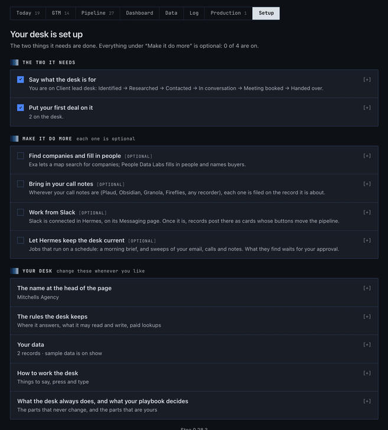

**Your name on it.** Type your business name and it is drawn in dots at the head of the page, lit
the way the stoa is: in place of the stoa, or beside it. **Auto / Color / One ink** says how the
two are drawn. On Auto they are in color on a dark theme and in one ink on a light one.

## Talking to the desk

A box at the foot of every tab takes the same sentences a chat does: *"Add Nadia Rahim from
Larkspur to the Northwind search"*, *"what needs me today?"*. The conversation opens above the box
and the page redraws behind it.

- **Its own conversation.** The page keeps one for this, called **Stoa desk**, listed in the
  sidebar like any other. **New conversation** starts a fresh one when it has grown long: the
  desk itself keeps everything, so nothing is lost. **Hide** (or Esc) folds it away.
- **Pick the model.** Under the box is the model the conversation runs on. Press it and Hermes's
  own model menu opens: search, your favourites, a custom model by name, and how hard to think.
  Map research has a model of its own, on the GTM tab.
- **Hand it a file.** Drop a CSV anywhere on the page and the desk reads it itself and shows the
  review, with no model in between, whatever the headers are called. Anything else you drop or
  attach (a PDF, a Word file, a picture; several at once if you like) goes to Hermes with your
  next message: *"here is the signed order form, update Northwind"*.
- **Say it.** The microphone dictates into the box where the browser has speech recognition.
- **Sentences, not commands.** A line that starts with `/` (such as `/blueprint`) is run by the
  app's own chat box, so the page opens a new chat with it typed and leaves it for you to send.

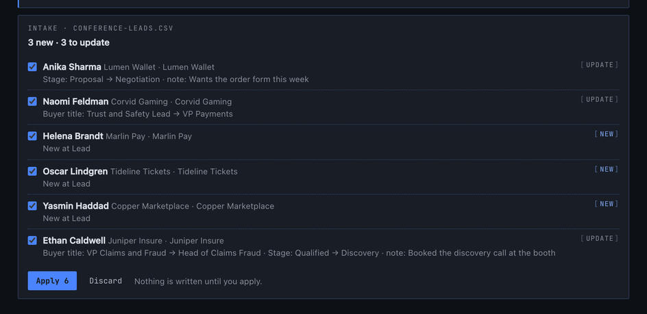

## In a Hermes chat

Stoa sits beside any conversation in the Desktop app and the Webapp.

- **A pane beside the chat.** What needs you today, every stage, the first calls from your map.
  Tell Hermes *"I spoke to Marcus, follow up Thursday"* and the pane redraws as the agent saves
  it. While the Stoa page is open the pane does not repeat it: it shows what is coming up this
  week and what has just changed.
- **Drawn in the conversation.** Ask *"show me Dana"* and the reply contains the live card, with
  its buttons, not a description of it. *"Show me the market map"* draws the map the same way.
  *"What needs me today?"* draws the day, with **Done**, **Draft** and **Snooze** on each row.
  *"How's our win rate?"* draws the report, with a period picker and the records behind each bar.
  A report Hermes makes for you arrives with **Keep it** and **Discard**.
- **A click saves, then Hermes writes.** Press **Draft follow-up** or the stage button on a
  record. The change is saved at once, one line goes into the open chat as if you had typed it,
  and the draft comes back in the conversation.
- **Everywhere else,** `/gtm` gives the board, today, cash, the brief, a map or one record as
  text: the terminal, Telegram, the phone app. `/gtm quiet`, `/gtm week` and `/gtm report` answer
  who has gone quiet, what moved this week and each pipeline by stage, for every pipeline at
  once, with no model.

## In Slack

A card in Slack (shown here as the text version every other surface gets):

```
Dana Whitfield · Kestrel Labs
▰▰▰▱▱▱  Screened · 3 of 6
Search: Staff Backend · Northwind
Fee: $42k
Current title: Senior Backend Engineer
Comp expectation: $210k base
Next: Send submission note to Northwind (due 2026-11-10)

[ Submit to client ]  [ Draft follow-up ]  [ Enrich ]  [ Passed… ▾ ]  [ ⋯ ]
```

Press **Submit to client** and three things happen, in this order:

1. The record moves to *Submitted* and the activity log records who clicked. Instant, in SQLite.
2. The card redraws itself, in every channel it was posted to.
3. Hermes gets a turn in the card's thread with the playbook's instruction for that stage
   (*"Draft the submission note to the client: three bullet points on fit, comp and
   availability, and one honest risk"*) and replies with the draft.

Two people clicking the same button at once move the stage once, not twice: the check and the
change are one database transaction, so it holds across Slack, the page and the agent.

`!gtm` shows the board (Slack keeps the slash for its own commands), and `!gtm Dana Whitfield` or
`!gtm map` posts the card or the map itself, buttons included.
