# What is in the plugin

Every part of Stoa, and its settings. For how a day on the desk goes, see [the guide](guide.md).

## What you get

| | |
|---|---|
| **13 tools** | `gtm_market`, `gtm_pipeline`, `gtm_deal`, `gtm_group`, `gtm_contact`, `gtm_invoice`, `gtm_card`, `gtm_intake`, `gtm_enrich`, `gtm_notes`, `gtm_playbook`, `gtm_export`, `gtm_report` |
| **Market maps** | Segments, fit scores, evidence and sources on one picture you work on: three views, pick and add to the pipeline, grow, weigh the requirements, a research model of its own, cost and limits per map, and a copy to hand a client |
| **Reports** | A dashboard and nine reports counted by the plugin from your records, with no model: pipeline by stage, win rate, time in stage, sources, losses, what the map turned into, what Hermes did. Make your own from a few choices, or ask Hermes for one in words |
| **Database** | Accounts, deals and people as tables: search, filter, sort, group, choose columns, keep views, change a cell in place, change many rows at once, copy emails and export |
| **Pipelines** | Several side by side on one desk, each with its own records and its own playbook: your own sales beside the work you do for clients |
| **Searches, accounts, clients** | The group a record is in is a thing of its own: who the client is, where it stands, its terms, and the people on the client's side |
| **Cash** | Invoices on a record in whole cents, what is owed and overdue, won work that was never billed, a delivery lane after the win, and a forecast weighted by stage |
| **Approvals** | What Hermes suggests waits for your yes or no, one decision each, with its evidence, or several of a kind in one press; a no is remembered; one you have already carried out closes itself; a scheduled job changes only what you allow |
| **Undo and a ledger** | Every change is kept with what it replaced, never altered; an action can be taken back unless that would overwrite a later change |
| **People and companies** | Several people on a record, each kept once across records, mail matched to the right record by whoever sent it, and one view per company |
| **Intake** | Send a list in any form; review what is new and what would change; apply what you tick |
| **Slack cards** | Advance, Draft follow-up, Enrich, close with a reason, snooze, reopen |
| **Desktop app and Webapp** | A live pane beside the chat, a Stoa page (Today, Market map, Pipeline, Reports, Database, Activity, Cash, Setup), and records, maps, the day and reports drawn inside the conversation |
| **Web dashboard tab** | Setup and status: the six set-up steps with how to do each from the dashboard, what the desk holds in totals, each pipeline and map, the month's paid work, the rules in force and your data |
| **`/gtm`** | The board, today, cash, the brief, a map or one record, on every surface Hermes runs on (CLI, Telegram, Desktop…). In Slack, `!gtm`, where a record or a map arrives with its buttons |
| **`hermes stoa`** | Status, board, brief, map, the ledger (`history`), autonomy, sample data, CSV import and export from a terminal |
| **7 automations** | Morning brief, email-call-and-Slack activity sweep, meeting-notes sweep, weekly market watch, Friday review, mirror to a Google Sheet, bring Sheet edits back, under `/blueprint` |
| **3 skills** | `stoa:desk` (how the agent runs the desk), `stoa:market-map`, `stoa:playbook-authoring` |
| **5 playbooks** | `b2b-sales`, `recruiting`, `agency`, `client-leads` (lead searches run for clients), `partnerships`, plus any you or the agent write |

### Market maps

*"We sell a fraud prevention tool to fintechs and marketplaces. Who should we go after?"*

Hermes names the market, splits it into segments that would each get a different pitch, and
agrees a short list of requirements with you: the things a fit company shows. Then it researches
companies for each segment, with its own web search or with [Exa](https://exa.ai) if you add a
key, and checks every one against those requirements. Each company goes on the map with:

- a fit score from 1 to 5, read off the requirements unless Hermes has reason to set it;
- the evidence for each requirement it shows, and the ones it does not;
- a buying signal, what it uses today, and the likely buyers;
- the source link.

```
Market map · Fintechs and marketplaces exposed to payment fraud
14 companies · 1 in the pipeline · 5 with a signal

Lenders and BNPL (3)
  ●●●●● Brio Credit · 190 people · Charlotte, NC  [in pipeline]
        New head of risk, and synthetic identities called out on the last earnings call.
  ●●●●○ Tallyup · 240 people · Salt Lake City, UT
        Pay-later at checkout for mid-size retailers; fraud is the processor's default.

Ticketing and travel (3)
  ●●●●● Encore Tickets · 160 people · Los Angeles, CA
        Bots and stolen cards on every big sale; chargebacks named in a customer notice.
```

The map then reads itself back. This is the part a list of names never gives you:

| | |
|---|---|
| **How rare each requirement is** | The share of checked companies that show each one. A scarce requirement is either too strict or the first question on every call. |
| **Who holds this market today** | What the companies use now. If most review by hand, you are selling against doing it by hand, not a competitor. |
| **Where the segments meet** | Companies that could sit in two segments: the second pool when one runs thin. |
| **Where they are, how big they are** | By region and headcount band. |
| **First calls** | The few to approach first and why, chosen by Hermes or, failing that, the strongest fits spread across segments. |
| **Reading the map** | Hermes's short interpretation and what to do about it, saved with the map. |

A map does not have to be of customers. On a recruiting pipeline it is a **candidate map**: a map
for one role, where every dot is a person with their own fit, their own checks against the role
and their own reason to move. The head of the map says which search it is for, and you can point
it at another. Adding a candidate makes them a record in that search: where they work as the
company, their title, the search's fee, and a first approach as what is next. Starting a map,
you say which search it is for and whether Hermes should look for more people or map only the
ones you name.

A new map on a recruiting pipeline holds candidates. The map's menu switches one to the older
kind, a map of the companies where such people work with people named under each, and back;
nothing on the map changes, only how it is read. Maps made before 0.28 stay maps of companies
until you switch them.

In Slack each company has an **Add to pipeline** button. A tap creates the record at the first
stage of your playbook with the first known buyer as the contact, carries the evidence into its
activity log, and asks Hermes to confirm the buyer (or find one) and draft a first-touch note.
The *Market watch* automation re-checks a map every week and adds at most five new companies.

**What Add to pipeline does**, from the page, Slack or a chat alike:

- **A company already in the pipeline is filled in, not added twice.** Stoa looks first for an open
  record filed under that company, spelled loosely ("Acme" and "Acme, Inc." are one). Found, that
  record takes the map's buyer and evidence, empty fields only, and the map shows the company as
  in the pipeline. A record that only mentions the company, such as a candidate who works there,
  is left alone.
- **On a pipeline of deals the record is named for the company**, and the buyer goes on it as a
  person (title, email, LinkedIn). The map never renames a record. On pipelines of roles and of
  leads the record is the person.

**The map on the page.** On the Stoa page the map is one picture you work on:

- **Three views of the same companies.** *Segments* is the map. *Priority* puts a better fit further
  right and a fresher reason to call higher up, so the top right is who to call first. A reason
  with a date fades over about two months; one with no date sits in the middle. *Held by*
  groups companies by what they use today.
- **Reading a mark.** Colour is fit, cold to hot. Size is what **Size by** says: the people who work
  there, the people you have named there (how a recruiting desk starts), or all the same. Solid
  is in the pipeline, a dashed edge arrived since you last looked, a ring is a reason to call. A dotted line
  joins a company to a second segment it also fits.
- **Act.** Click a company to open it; shift-click, drag across the map or tick rows in the table to
  pick several. Then add them to the pipeline, name a buyer at each, have Hermes draft outreach, or
  dismiss them. **Dismissed** puts one back. **Find buyers** is one People Data Labs lookup a
  company, for one person whose title is like the buyers already named on the map and whom People
  Data Labs ranks manager or above, so an analyst who shares a word with the buyer is not saved as
  one. Where nobody of that rank matches, nothing is saved or spent. The button says the most it can
  spend. Read the title before you use a name. With no buyer named yet, or no key, Hermes works out who the buyer is.
- **Grow.** **+ Grow** under a segment, **More like this** on a company and the faint ring for a
  neighbouring segment each send Hermes a line in the box at the foot of the page. What it finds
  lands on the map, marked as new until the next time you open it.
- **Adjust.** Under **What matters**, set each requirement to Off, Nice, Matters or Must and fit is
  worked out from your weights for every company Hermes checked. A new requirement typed there
  goes to Hermes to check against every company. A company moves to another segment from its panel.
- **Filter.** The breakdowns (who holds the market, how big they are, how rare each requirement is)
  are buttons: press one and those companies light up on the map and in the table.
- **Your maps.** The map's name at the top is a list: press it to switch to another map, start a
  **New map** (say what you sell and who to, and Hermes goes and maps it; the new map shows itself
  when it is saved), **Rename** this one, or **Delete** it. Deleting asks first, takes the map and
  its companies for good, and leaves any record already in your pipeline where it is. Only a person
  at the page can delete a map; Hermes has no way to.
- **The company panel stays with you.** On a wide page it sits beside the map and follows as you
  scroll, so a company picked from the table opens where you are looking. On a narrow page it sits
  under the map and the page goes to it.

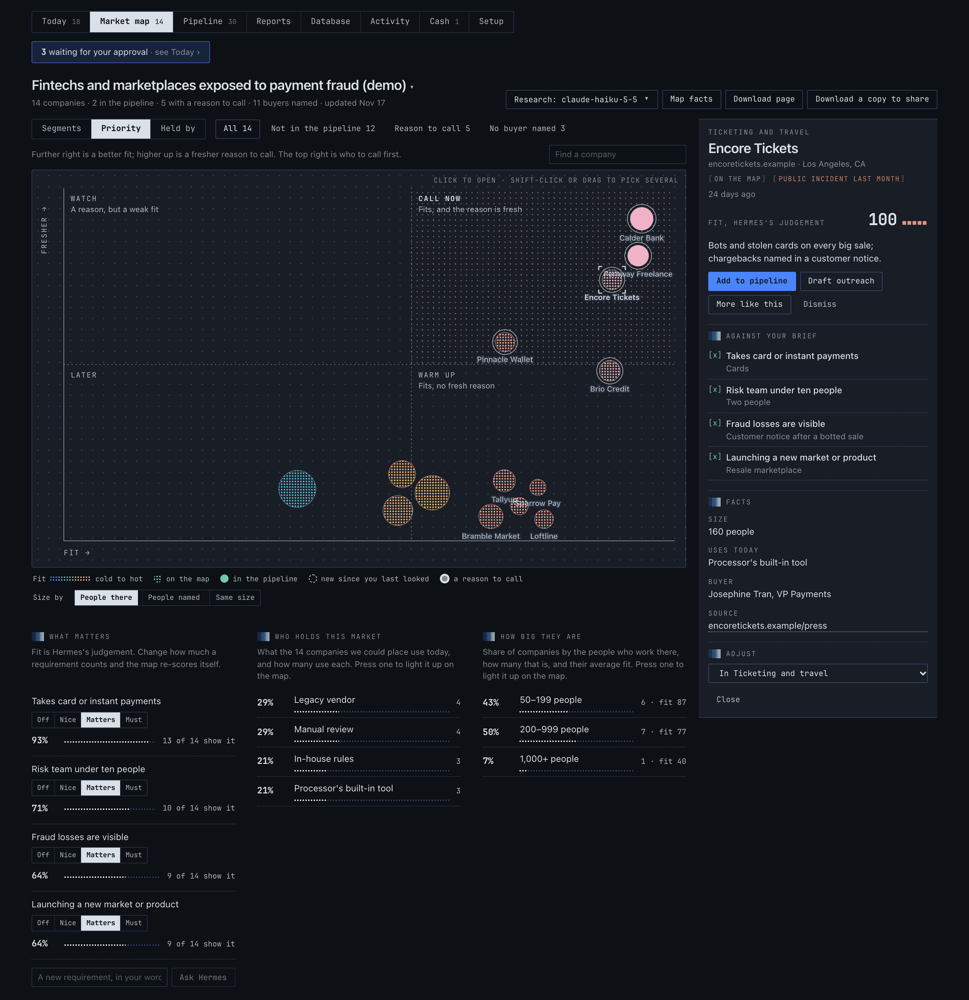

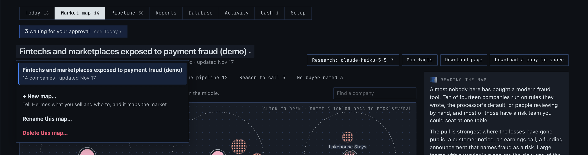

**The research model.** **Research:** beside **Map facts** is the model Hermes researches maps
with. Starting a map, **+ Grow**, **More like these**, a new requirement, a neighbouring segment,
working out a buyer and **Ask Hermes to fill in what is missing** all go to a conversation of their
own, **Stoa map research**, on that model. It starts on Hermes's default and does not follow the
model picked under the talk box. Pick any model Hermes can use; the pick is kept on that computer.
**New research conversation**, at the foot of the same list, starts a fresh one when it has grown
long. **Draft outreach** is writing, not research, and goes to the talk box's conversation.

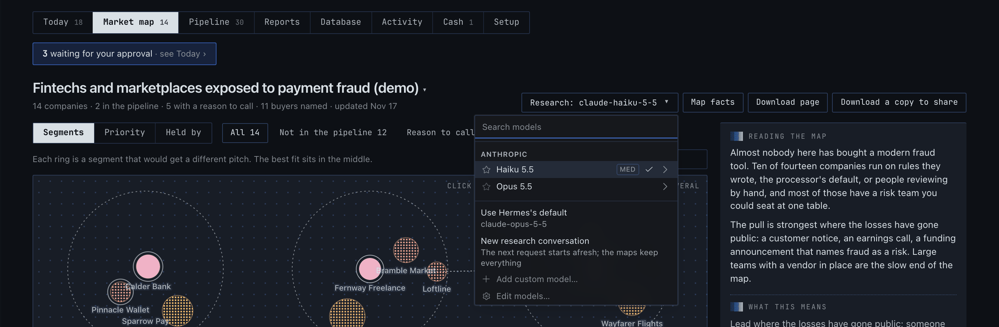

**Map facts.** The **Map facts** button opens a window with the map by the numbers:

- **What is on it.** Companies, segments, how many are in your pipeline or dismissed, and how
  complete the map is: how many companies are checked against the requirements, have a source link,
  a headcount, what they use today, a buyer named, and a date on their signal. **Ask Hermes to fill
  in what is missing** sends Hermes a line naming exactly those gaps.
- **Where it came from.** How many source links the map holds and the sites they come from.
- **What it has cost.** Hermes's own estimate, in dollars, of the model calls made by the turns that
  worked on this map, with the turns, calls, minutes and tokens behind it, and this month's share.
  Beside it are the People Data Labs lookups and the Exa searches made through Stoa for this map.
  Counting starts with the first turn after this is installed; work done before that is not in the figure. It is an
  estimate from the provider's price list, not an invoice, and a model Hermes has no price for (a
  local one, say) shows "No price known" with the token counts.
- **Limits for this map.** Four boxes, each empty for no limit: how many companies the map may hold,
  how many dollars of Hermes's work a month, how many People Data Labs lookups a month, and how many
  Exa searches a month. Hermes is told the limits when it opens the map, **Grow** and **More like
  these** ask only for as many companies as there is room for, and at a limit Stoa refuses the next
  company, search or lookup and tells Hermes to stop and tell you. A limit cannot stop a turn that
  is already running: the budget is checked each time Hermes goes to add or search, and a turn's
  cost is written when the turn ends.

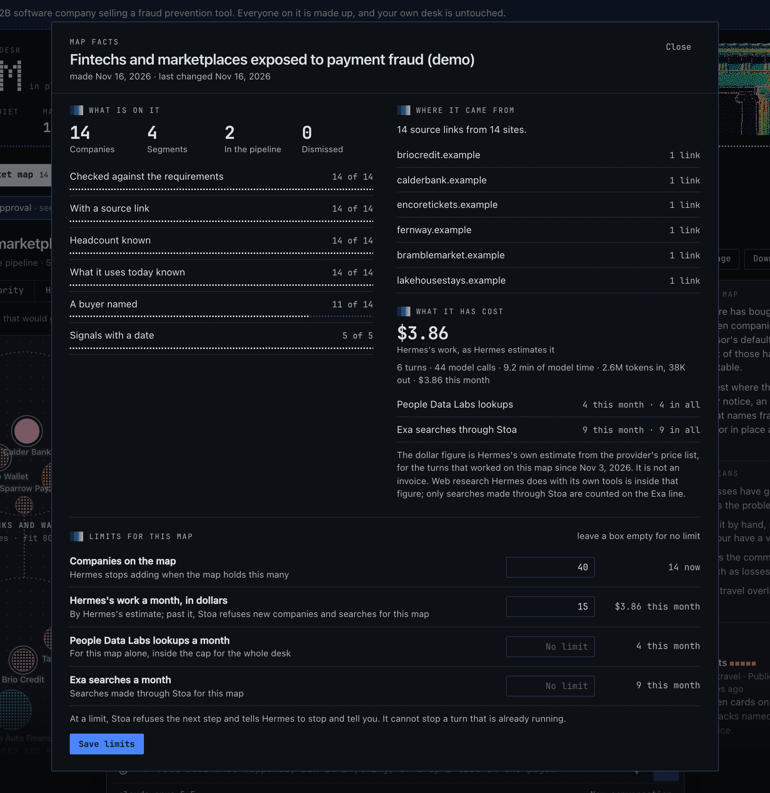

**A page to send.** **Download page** on the Market map tab saves the whole map as one
self-contained web page, with the same working map at its head: the three views, a company opened by
a click, and the requirements weighed on the spot. It makes no outside requests and depends on
nothing; the one script in it is the map's own, written into the file with the companies beside it.
A browser that runs no scripts shows a still picture instead. **Download a copy
to share** saves the same page without buyers' names or what is in your pipeline, for hosting or
sending to a client. Asking Hermes does the same (`gtm_market(action="export")`), and writes the
file to the plugin's `exports/` folder instead of your browser's downloads.

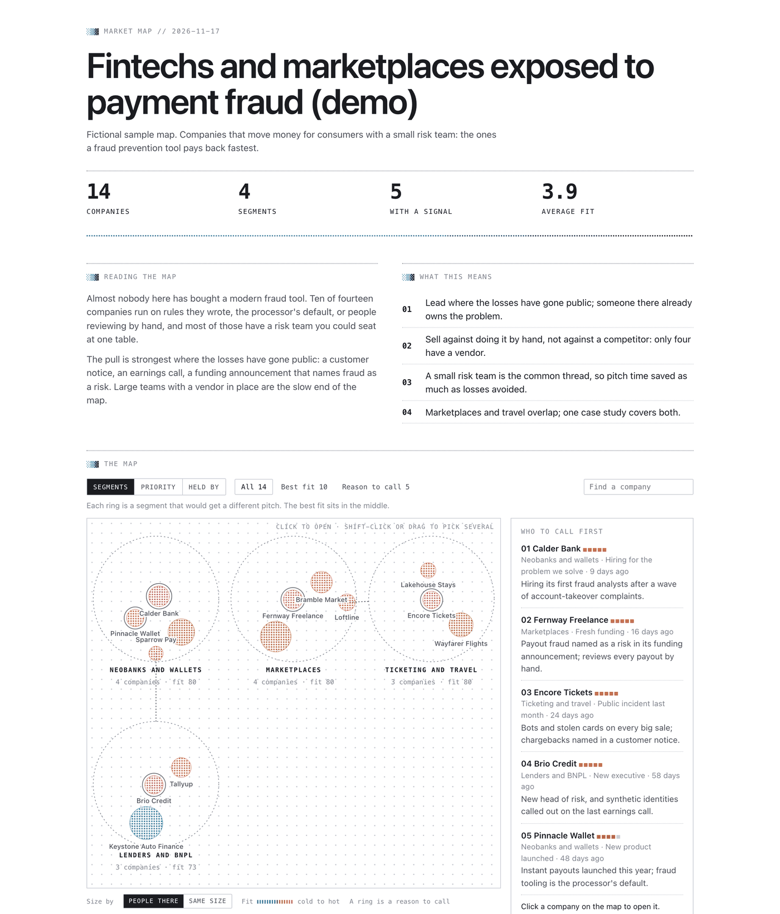

### Intake

*"Here's the attendee list from the conference."* (with a PDF attached)

Hermes reads the file and hands Stoa the rows. Stoa then works out, with no model involved, what
each row would do:

| | |
|---|---|
| **New** | Nobody like this on the desk. It would be added at the first stage, or the stage the file gives. |
| **Update** | Already on the desk, and the file knows something the record does not, or says something different. Every change is listed: `stage Contacted → Screened`, `LinkedIn added`. |
| **Already there** | On the desk with nothing new. Left alone. |
| **Unclear** | Could be more than one record. Stoa asks which. |

Headers can stay as they were written: "Client Name", "Contact email", "Lead name", "First name"
and "Last name", "Deal Owner" are read for what they mean, whatever the case, spacing or
punctuation. A column the desk has no place for (a phone number, a website) is not dropped: each
new record keeps it in its notes, in the list's words. If no column reads as a name at all, the
page hands the file to Hermes to read, and Hermes asks you if it cannot tell either.

When a list has columns with no place on the desk, the review lists them with a choice for each:
**Keep in notes** (each new record's notes, the default), **Add as a field** (the playbook gains
it, so every record has it from then on), or **Leave out**. In a chat, Hermes asks.

A person is matched by email first, then LinkedIn, then name and company. The same person in a
different account or search is a new record, not an update. Nothing is written until you press
**Apply** in the app or in Slack, or say "apply all but 3". Two people pressing Apply write the
list once. A CSV on disk is read by the desk itself, in Excel's encoding too.

### The pipeline

Everything lives in one SQLite file under `<hermes home>/plugin-data/stoa/desk.db`: records,
the people on them, their activity log, which cards were posted where, and the enrichment cache.
It is per profile, it survives plugin updates, and you can open it with any SQLite tool.

- **A ledger of every change.** Beside the log a person reads, the file keeps a ledger: one line
  per change to a record or a person, with who made it, what it replaced and what it left. The
  database itself refuses to alter or remove a line, so it is the account of what happened, and
  it is what Undo reads. `hermes stoa history [record]` prints it.
- **Money in whole cents.** Amounts are stored as integers and added up as integers, so a
  pipeline total is exact. (The old decimal column is still written beside it, so an older
  version of the plugin can read the same file.)
- **Nothing destroys a record by accident.** Taking back an add, or pressing **Delete** on a
  record's page, takes the record off the desk and keeps it, with everything on it; *"bring Ada
  back"* (`gtm_deal(action="restore")`), **Put back** on the Activity tab, or **Your data** in
  Setup returns it with its log. Only **Delete for good**, in Your data, destroys one, and only
  a record already taken off the desk. The agent cannot delete a record at all.
- **A record is found wherever it is.** On a desk with several pipelines, a record named without
  its pipeline is looked up in all of them: the call goes to the one that has it, to the one
  still open when a lead and the deal it became share a name, and nowhere when two are open (the
  answer lists both, to be asked about). A note filed or skipped in one pipeline is done with on
  the whole desk, so it is not filed twice.

Talk to it in plain language. *"Add Dana from Kestrel to the Northwind search." "I spoke to
Marcus, he wants 210 base, follow up Thursday." "We lost Lumen on price."* The agent writes each
of those to the desk in the same turn; the bundled skill teaches it to treat the desk, not its
memory, as the source of truth.

**The funnel and the board.** On the Pipeline tab the large number over each stage is every record
that got as far as that stage, those now further on or won included ("got this far"); the small one
is what the column holds ("here now"); the percentages are the share that reached the next stage. A
card on the board shows its contact (or company and group), the next step on two lines, and a row
along its foot: when the step is due, how long the record has been in its stage, quiet, a draft
waiting, how many people are on it, and the owner. A card overdue or due today has a coloured edge.
Resting the pointer on a card opens a panel beside it with the stage, the next step, up to three
people, the notes and the last three things logged; it takes no clicks and goes when the pointer
does.

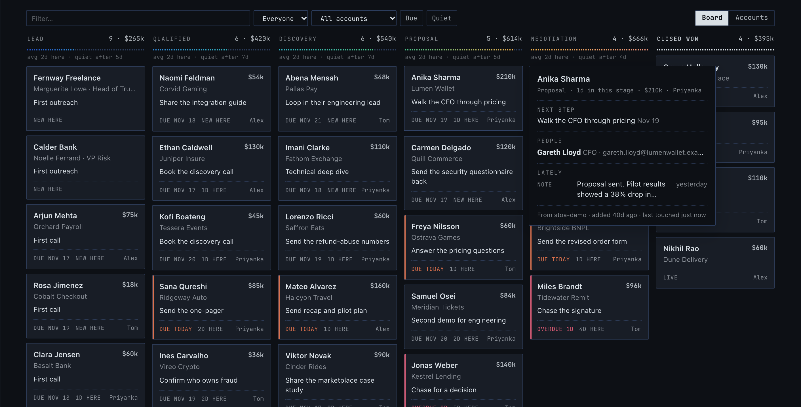

Every record carries one next step and a date. *"What needs me today?"* (or `/gtm today`) answers
with the same list the Today tab shows. *"Done, I sent the references"* logs the step and sets
the next one. *"Park Kestrel until the 20th"* snoozes it: a snoozed record is on neither the due
list nor the quiet list, in the page, the morning brief or Slack, until its date.

**A won record keeps its next step until delivery is through.** Where a playbook names two or more
delivery stages (Onboarding → Live, say), a won record short of the last one still has a next step
that shows and comes due like an open record's: on Today, in the brief, on its page and on the
board. Winning it on its page asks for the first one, and Today lists wins in delivery with nothing
planned. At the last delivery stage a win is closed.

### Approvals, autonomy and undo

In a chat you are there, so Hermes does what you ask. The rest is for when you are not.

- **A scheduled job cannot outrun you.** The desk has one setting, changed only on the Setup tab
  or with `hermes stoa autonomy <ask|routine|full>`: no tool can change it, so the agent cannot
  raise it. **Ask me first** (the default): a job may log what it finds, and every other change
  waits for you. **Handle the routine**: it may also set next steps, fill in facts and add people
  to a record. **Run it**: it may make any change. This is enforced in the plugin, not in the
  prompt: a change the setting does not allow is not made, it becomes a proposal.

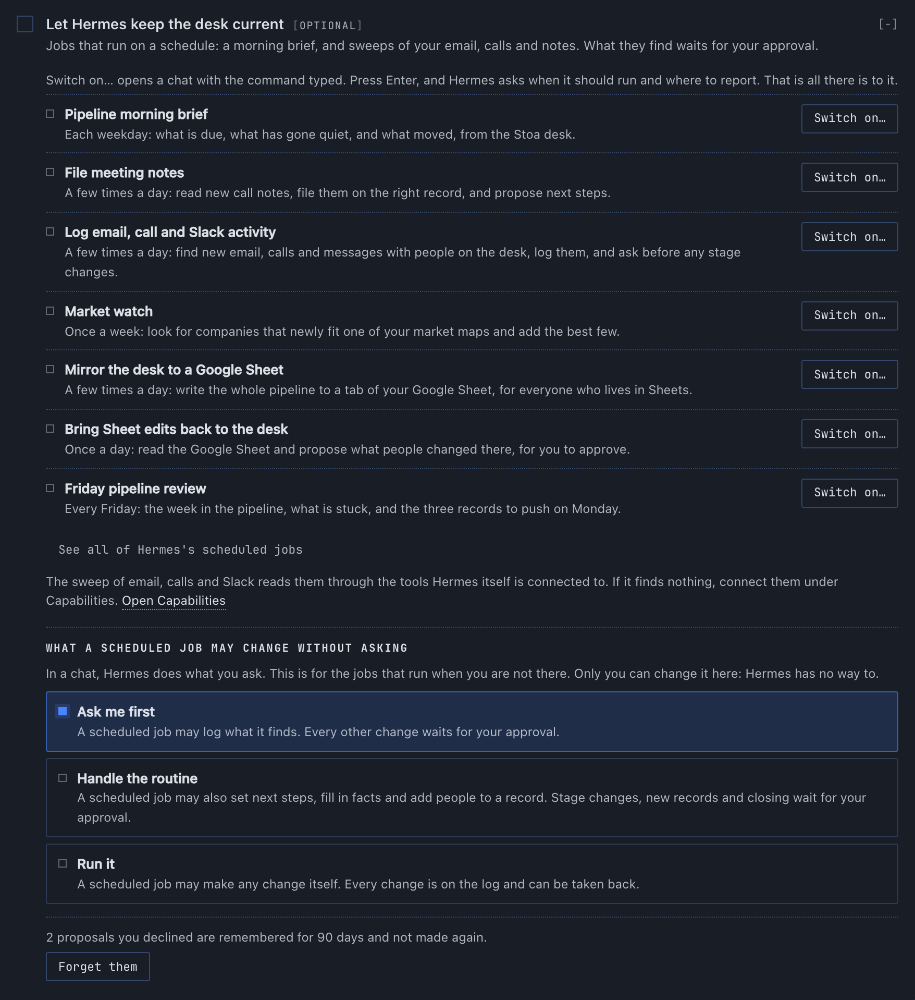

- **A proposal carries its case.** The record, what would change, one line of why, and up to four
  pieces of evidence: an email, a call, a message, with who and when and their words. You approve
  or decline each on Today (or apply a whole list at once). Approving is a person's: a scheduled
  job cannot apply or discard what is waiting.
- **A suggestion that did not know a record was there cannot undo it.** When a sweep proposes a
  "new" record that turns out to match one already on the desk, the match is held as a change to
  that record, and its stage is left alone: it never reopens a record that is won or lost, and
  never steps an open one back to the first stage. The review says so. A row that names its record
  by id still moves it wherever it says. The same suggestion is not held twice while the first
  waits.
- **A no is remembered.** A declined proposal is kept for 90 days and the same one is left out
  if it comes again. It is the same one only while the record has not moved: once the stage or
  the value it would replace changes, it counts as new. **Forget them** on Setup clears the memory.
- **Everything can be taken back.** One action (a click, a tool call, an approved proposal) is
  undone as one: *"undo that"*, the Undo offer on the page, or `gtm_deal(action="undo")`. It takes
  back the last action on a record, then the one before. An undo never overwrites a later change:
  if something the action set has been changed again since, nothing is taken back and you are told
  what stands in the way (*"Deal size is now $60k; that action left it at $50k"*). An earlier
  action whose values are untouched still goes back, whatever was logged after it. Undoing an add
  takes the record off the desk, and it can be put back.

### Reports

The **Reports** tab is the desk added up. Every figure on it is counted by the plugin from the
pipeline's own file, so a report costs nothing to open, reads the same every time, and never
depends on a model getting the sum right. Reports belong to a pipeline: each one has its own.

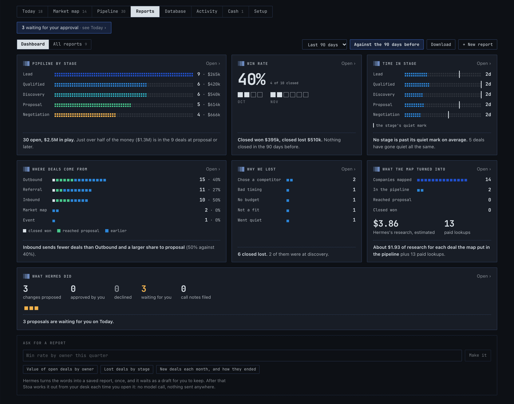

**The dashboard** shows the reports you have pinned, each with one sentence on what its figures
say. Seven are on it to begin with:

| Report | What it counts |
|---|---|
| **Pipeline by stage** | What is open now at each stage, and what it is worth |
| **Win rate** | Of the records that closed in the period, the share that were won, one square for each, month by month, against the same stretch before |
| **Time in stage** | How long the open records have sat in each stage, on average, against that stage's quiet mark; and from the ledger, how long the ones that left it had stayed |
| **Where records come from** | The records that entered in the period, by source, coloured by how far each got. Every market map counts as one source |
| **Why we lost** | The records closed as lost in the period, by reason, and the stage most were lost at |
| **What the map turned into** | Companies mapped, how many went into the pipeline, how far those got, what was won, and what Hermes's research on the maps is estimated to have cost |
| **What Hermes did** | What a scheduled job proposed in the period, what you approved and declined, what is waiting, and the call notes filed |

Two more are under **All reports**, ready to pin: **Who holds what** (open value by owner) and
**New records by month**. The period (30 days, 90 days, this quarter, this year, all time) and
**Against the … before** apply to every report that has a period; a report of what is open now
has none.

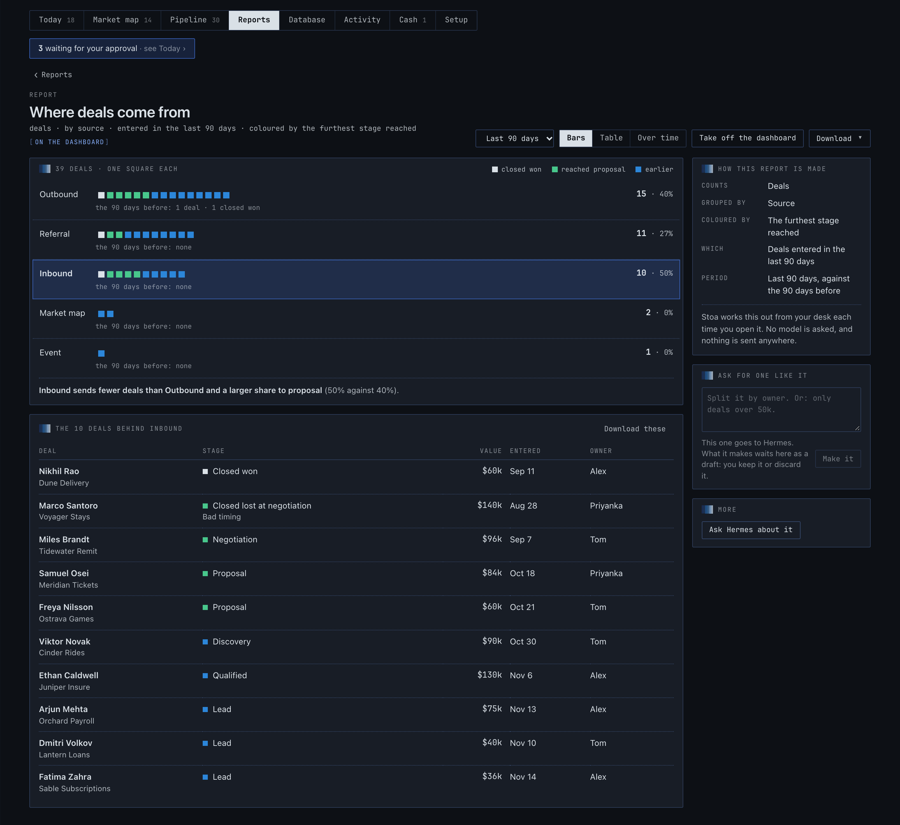

**Open** a report to see it large: press a bar and the records behind it are listed, each one a
press away. **Table** shows the same rows as numbers, **Over time** the same records month by
month. **How this report is made** says, in plain lines, what it counts and over which records.
**Download** saves it as a page (one file, no script, figures only: it names no record) or as a
spreadsheet.

**Your own reports.** **+ New report** makes one from a few choices, on the page, with no model:
what it counts (records, or what they are worth), what the bars are (source, owner, stage,
group, company, reason lost, month, or one of the pipeline's own fields), which records (entered
in the period, closed in the period, or open now), what colours each bar (the furthest stage
reached, or how it ended), and a narrowing (a status, an owner, a least value). Open it and press
**Change** to alter the choices later.

**Or ask in words.** *"Win rate by owner this quarter."* Typed into **Ask for a report**, or said
to Hermes in any chat, the agent turns the words into the same few choices with `gtm_report` and
saves the result **as a draft**: it opens on the page for you to keep or discard. **Change it in
words** on a report of your own does the same and offers the new version in place of the old.
Hermes is used once, to make the report; after that Stoa works it out.

*"How is the pipeline doing?"*, *"what's our win rate?"*, *"where do our best leads come from?"*:
in a chat the agent reads the matching report (`gtm_report(action="read")`) and says what it
shows; it does not add records up itself. A scheduled job can read reports and cannot add or
remove one.

What the figures rest on:

- **A day is the day where the desk is.** Times are kept in UTC and counted by the local date of
  the machine Hermes runs on, so what you close in the evening is in today's figures.
- **When a record closed** is when it was moved to won or lost; **when it entered** is when it was
  added to the desk (for an import, the day of the import).
- **How far a record got**: an open one, its stage; a won one, all the way; a lost one, the stage
  it was closed from. "Reached" a stage means that stage or later. The stage that opens the second
  half of your pipeline is the one a source is judged by (for five stages, the fourth).
- **Time in stage** for records there now is days since each reached the stage. The "left after"
  figure reads the ledger, so it only knows moves made on the desk since they were made here; a
  move made within a minute of the one before is taken as a correction and left out.
- **Source** is the record's own source field, and the report is only as good as it is filled in. A
  market-map record, a list and an import are marked by Stoa; any other record has a source only if
  someone gave one. So the new-record form has a **Source** box that suggests the names already in
  use, and when Hermes adds a record without one the tool tells it so, and it asks you once. A record
  with none is counted under **Not recorded**; when two in five or more are, the card says so in
  place of a comparison. Open the report, press **Not recorded**, and type each one's source in the
  list: it is saved on the record, which moves to its own bar.
- **What Hermes did** counts proposals, which are what a scheduled job leaves for your approval.
  What you ask Hermes to do in a chat is done at once and is not a proposal.

### The database

The Pipeline tab shows work by stage. The **Database** tab is everything the desk keeps, as rows to
look through. The rows are worked out from what the desk already holds; nothing new is stored but
the views you save.

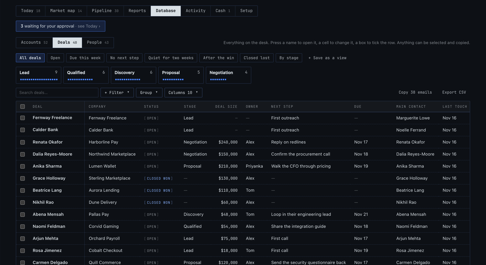

| List | A row is | Columns include |
|---|---|---|
| **Accounts** | A company with a record, or a company on a market map | Status, open deals, open and won value, people, next step, due, last touch; for a mapped company its segment, fit, size, location, signal and map |
| **Deals** | A record, open, won or lost | Company, status, stage, value, owner, next step, due, main contact, last touch, source, expected close, and the playbook's own fields |
| **People** | A person, once, however many records they are on | Title, company, email, phone, role, the records they are on, last touch |

- **Search and filter.** A filter is a column, a test and a value: is, is not, contains, is empty,
  at least, at most, before, after, within the last or the next N days.
- **Sort, group, columns.** Press a heading to sort. **Group** puts rows under a heading for each
  value with a count and a sum. **Columns** chooses what each row shows.
- **The boxes above the table** count the rows by stage, status or company, and filter when pressed.
- **Views.** A set comes with it: for deals *Open*, *Due this week*, *No next step*, *Quiet for two
  weeks*, *After the win*, *Closed lost*, *By stage*; for accounts *In the pipeline*, *Customers*,
  *Nobody named yet*, *On a map, not in the pipeline*; for people *On open deals*, *No email yet*,
  *By company*. **Save as a view** keeps your own, up to 40 a pipeline, and the page remembers
  where you were.
- **A cell is changed in place.** On a deal: owner, value, next step and its date, stage, delivery
  stage, source, expected close, notes and the playbook's own fields. On a person: name, title,
  email, phone and LinkedIn. On an account: website and notes. Each save goes through the route
  the record's own page uses, so it is logged on the record and **Undo** is offered. A name opens
  what it names; a pencil renames it. A cell worked out from other things is not editable.
- **Rows are ticked** (Shift for a run) and one change is made to all of them: owner, stage, next
  step, source, expected close, closed as lost. Each record is changed one at a time and logged;
  one the change does not fit is skipped and named. Companies that are only on a map are added to
  the pipeline the same way.
- **Copy emails** and **Export CSV** take the ticked rows, or every row shown when none is.

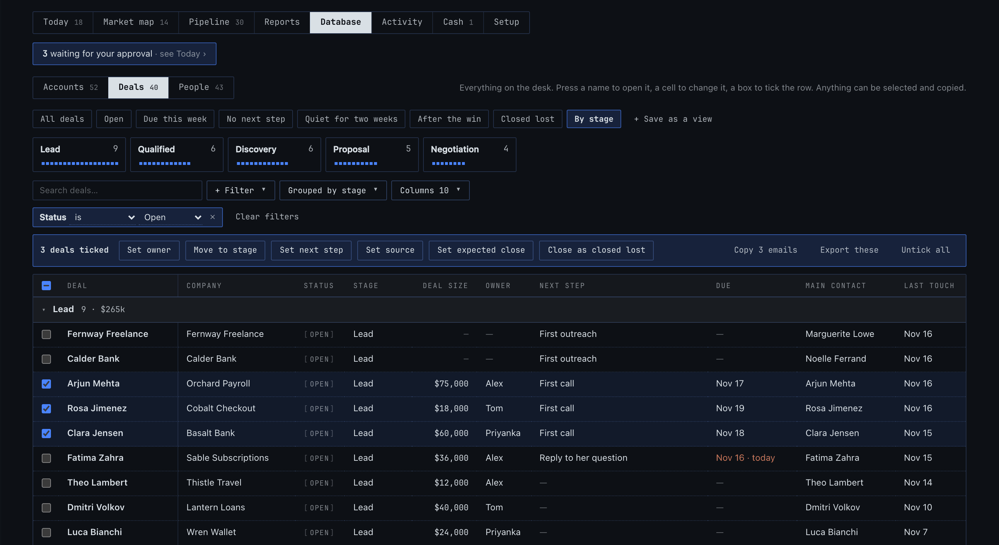

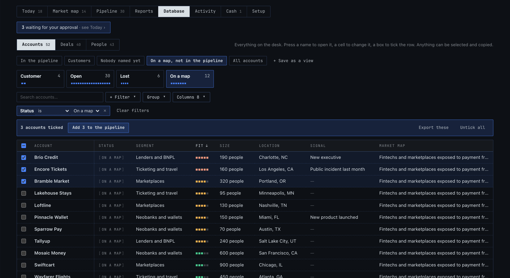

The database has no tool of its own: in a chat, Hermes reads and changes the same records with
`gtm_pipeline`, `gtm_deal` and `gtm_contact`.

### Cash: invoices, delivery and the forecast

*"I invoiced Kestrel 12k today, net 30." "Kestrel paid half of 1042." "How is cash looking?"
"What is likely to close this month?"*

- **Invoices** live on a record (`gtm_invoice`): add one (the amount defaults to whatever of the
  record's value is not billed yet, the due date to thirty days out), record a payment in part or
  in full, void it, correct it. Amounts are whole cents; an invoice is *overdue* when it is past
  its date and not paid in full, and *part paid* in between. Every change is on the ledger and
  can be taken back. Stoa sends nothing and moves no money.
- **Today** lists invoices that have gone overdue (with **Paid**, and **Draft a reminder** for
  Hermes to write), and, once you keep invoices on the desk at all, recent wins nobody has billed.
- **After the win**, a record sits in a delivery lane that your playbook names (`delivery:` in the
  YAML: Kickoff → In delivery → Delivered, say). Drag it along, or tell Hermes.
- **The forecast** weights each open record by how likely its stage is to close and puts it in
  the month of its expected close date (`close_on`, the **Expected close** field): past its date,
  this month, next month, later, no date. The odds come from this desk's own history once twelve
  records have closed; before that, from `win_probability` on each stage of the playbook; failing
  that, an even climb.
- **Hermes proposes, here too.** A sweep that sees a remittance email proposes the payment, with
  the email as evidence, for you to approve. A scheduled job never records money by itself
  unless you have set autonomy to *Run it*.

`/gtm cash` (or `gtm_pipeline(view="cash")`) gives the same picture in any chat.

**Billing a client by the month.** Work that is billed to a client rather than on a record
(contract hours, a retainer) is set up on the client: **Billing → Set terms** on its page, or
*"I bill Fernway 95 an hour, 40 hours a week, monthly, to Halyard Ventures"*. The terms are hourly (a rate,
the usual hours a week) or a retainer (an amount a month), who the invoice goes to when that is
someone else (a fund, a parent company), and the first month. Each month that has ended and is
not billed waits on **Today** and in **Cash** under *To bill*, at the month's weekdays times the
usual hours: change the hours if the month was short, then **Record invoice**, or **Skip** it.
Those invoices count in Cash with the rest (owed, overdue, collected) and are taken back the same
way. A playbook with `billing: none` (lead searches done for clients) bills no record, but its
clients can still be billed this way, and then it has a Cash tab.

### People and companies

*"Add their CFO, Lena Ortiz, to the Kestrel deal." "Who do we know at Kestrel?" "What do we have
going with Northwind?"* A record keeps its own person and any number of others. A person is kept
once and linked to each record they are on: add someone by an email the desk already knows and
they are linked, not entered twice; their title and email are theirs everywhere, and their role
is their part in one record. `gtm_contact(action="match")` tells the agent whose an email address
is: the record it belongs to, through anyone on it, or, for a stranger, the company their domain
belongs to and that company's open records, so a sweep files mail in the right place and can
propose adding the sender. A company is not something you set up: it is every record that names
it, however the name is written ("Kestrel Labs, Inc." and "kestrel labs" are one), plus the notes
and the email domain you keep on it.

### How a recruiting pipeline is paid for

A recruiting pipeline is **contingent** or **contract**; **Billing** at the head of the Pipeline
tab says which and changes it. Each pipeline keeps its own.

- **Contingent**: a fee for each placement. What is in play counts each search's fee once for
  each opening still to fill, however many candidates are in it: six candidates in a $30k search
  are $30k in play, not $180k. On the board, in the funnel and on Today that fee sits in the
  stage of the search's furthest-along candidate, so on the whole board the open stages (Other stages included) add up to
  what is in play. The funnel does not draw stages that are not the playbook's. The Placed column is apart from that, and a filtered board works out who is
  furthest along among the candidates it shows, so two filtered boards can add up to more than
  what is in play. A search hiring for more than one seat has **Openings** on its
  page; a seat that is filled, and a search marked done or closed, stop counting. The forecast
  works the same way, a search at a time.
- **Contract**: paid by the hour by one company, on any number of searches, and billed each
  month. You give the company, the hourly rate and the hours a week. No candidate carries a fee
  and the Pipeline side counts candidates, not money. A placement made before the pipeline was
  contract work keeps its fee and is billed and paid as before; a candidate placed while it is
  contract work brings none, and is marked so. Fees that candidates carried from before are left
  out, not lost: an open candidate's is back if the pipeline is made contingent again, unless
  you clear them. Clearing writes to zero the amounts on open and passed records still on the
  desk, on placements made on contract work and on every search. Undoing the clearing on a record
  puts its amount back (a placement made on contract work still shows none; a search's has to be
  typed again), and the ledger keeps what each was. The Cash tab shows the contract, the month
  in progress at the hours agreed, and each month that has ended, ready to bill; you can correct
  a month's hours before recording its invoice.

With more than one pipeline, the Cash tab opens with all of them side by side: this month,
collected, owed, overdue, to bill and likely to come, a contract's month of hours beside the
others' fees.

### Several pipelines on one desk

One desk can hold up to six pipelines. Each has its own records, its own playbook, its own
autonomy setting and its own file, so a consultant can keep their own sales (`agency`) beside the
lead work they do for clients (`client-leads`) without one set of stages bending to fit the other.

- **Open one** under **Setup → Pipelines** (a name and the playbook it runs on), or say "add a
  pipeline for my own deals on the agency playbook". The first pipeline is the desk you already
  have; a desk that never adds another behaves exactly as before.
- **On the page**, a row of pipelines sits above the figures. Press one to see it; every tab then
  shows that pipeline.
- **In a chat**, name the pipeline ("on my practice pipeline, add Visa"). Left out, Hermes means
  the first, and every answer says which pipeline it used. A record looked for in the wrong one
  comes back with where it is. "What needs me today?" answers for all of them.
- **In Slack**, a card and its buttons belong to the pipeline the card was posted from.
- **From a terminal**, `hermes stoa pipelines` lists them (`add`, `rename`, `remove`), and
  `--pipeline NAME` points any other command at one.

### Searches, accounts and clients

A record names the group it is in: a search, an account, a client, a program, in your playbook's
word. The group is a thing of its own, kept under that name however it is typed:

- **The client.** The company it is for, and so the company that pays. In recruiting that is not
  the candidate's own company; a record in the search shows it, and so does an invoice.
- **Where it stands.** Open, on hold, done or closed.
- **Its terms.** What one record in it is worth (a new record takes that unless it brings its own),
  and the facts your playbook names for a group: for a search, fee type, fee %, target base,
  hourly rate, hours, contract end, location, guarantee. A playbook lists its own under
  `group_fields:`.
- **The people on the client's side.** A hiring manager or a sponsor belongs to the search, not to
  one candidate. Put there, their mail is recognised as being about that search, and "who do we
  deal with at Northwind?" finds them.
- **Notes**, and every change on the ledger.

Where a group is a company (an account, a client: a playbook with `map_group: company`), the
group's page also holds the company's email domain and everyone on its records, so there is one
place to look. A playbook with `billing: none` (the shipped `client-leads`) never bills a record:
there is no Cash tab, and no invoices on a lead.

**One client's list by itself.** *"Export the Northwind search"* writes a CSV of that search and
nothing else (`gtm_export(action="export", group=...)`, or **Export as CSV** on its panel). A
client's name in place of a search's gives everything that is for them. **Copy to share**
(`share=true`) is the file to send them: your words for the columns and stages, and none of your
own business (value, owner, next steps, dates, where a lead came from).

**From a market map.** A playbook says where a company added from a map goes (`map_group`): into
the group named after the map, when a group is something you run and fill (a search, a lead list
for a client), or into a group of its own, when each company is an account. The `client-leads`
playbook is the first kind: name a map after the search, and its companies land in that search.

*"We are starting a Staff Backend search for Northwind at 20%"* opens one. On the page, the
Pipeline tab lists them beside the board and the companies; press one for its records, its
people and its terms. `gtm_group` is the tool; `gtm_contact(group=...)` keeps the people.

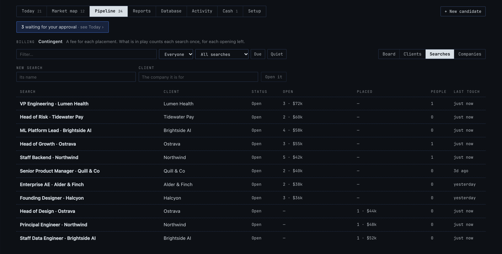

### Playbooks

On the page, a pipeline is set up from one of three shapes and its own stages (see the guide);
`gtm_playbook(action="stages")` does the same in a chat. Underneath, a playbook is a short YAML file:

```yaml
name: recruiting
terms: {deal: candidate, deals: candidates, group: search, groups: searches, value: Fee}
stages:
  - {id: screened, label: Screened, stale_days: 3, advance: Submit to client}
  - {id: submitted, label: Submitted, stale_days: 4, advance: Client interview}
won:  {id: placed, label: Placed}
lost: {id: passed, label: Passed, reasons: [Not a fit, Comp mismatch, Client passed]}
drafts:
  on_enter:
    submitted: >
      Draft the submission note to the client for {name}: three bullet points on fit, comp and
      availability, and one honest risk. Quote only what is in the notes.
```

`stale_days` decides when a record counts as gone quiet at that stage. `advance` is the label on
the button. `drafts.on_enter` is what Hermes writes when a record arrives at a stage. An optional
`door` is the short name the first-launch chooser shows for it. Two more optional keys feed the
Cash tab: `win_probability` (0 to 100) on a stage, and a top-level `delivery:` list of what
happens after a win.

To make your own, tell Hermes how you sell: *"We install commercial solar. Set the desk up for
us."* It asks a few questions, shows you the stages, and saves the playbook. Or copy one from
[`playbooks/`](playbooks/) into `<hermes home>/plugin-data/stoa/playbooks/` and edit it.

### Meeting notes

Call notes reach the desk three ways, and any mix of them:

- **Folders** (`notes_dir`, up to eight, a semicolon between them): an Obsidian folder, wherever a
  recorder such as Plaud exports to, files you drop in by hand. Stoa reads Markdown, text, Word,
  subtitle, web-page and rich-text files, three folders deep. A meeting's transcript and summary,
  saved as two files, are one note. A PDF is handed to Hermes to read with its own tools.
- **A key**: Granola or Fireflies. Summaries and action items only; a transcript is never asked for.
- **A connector Hermes already has** (`notes_connections`, for example `plaud`): Hermes reads the
  notes there with that connector's own tools and files them here under an id of its own, so each
  is filed once (`gtm_notes(action="known")` tells it which are new). New, and only as good as the
  connector.

A note is filed once: it stays filed when its file is edited, saved again, renamed or moved, and
`gtm_notes(action="reopen")` puts one back in the inbox when a person asks for it.

`gtm_notes` lists the notes that have not been filed and which record each one is probably about,
with why: an attendee, a name or company in the title, or a person, an email address or a company
named in the note. The agent reads a note, files a short summary on the right record with the
next step, and recommends a stage change for you to confirm. The *File meeting notes* automation
does this a few times a day, and **What Stoa would pick up** on Setup shows the same list, with
no model involved, before any of that has run.

### Enrichment

With a [People Data Labs](https://www.peopledatalabs.com/) key, the **Enrich** button and
`gtm_enrich` look up a person or company and fill the record's blank fields. It never overwrites
what a person typed, results are cached for 90 days, and a monthly cap (default 50 lookups)
keeps the bill predictable. A playbook with `enrich: none` removes the button and refuses the
lookup, for teams that do not want it at all.

### Gmail

Stoa writes drafts and never sends. When the Google Workspace skill (or any Gmail tool) is
connected to Hermes, the agent saves what it drafts as a Gmail draft addressed to the record's
email, ready for you to read and send, and reads the draft back before telling you it is saved.
Without Gmail, drafts arrive in the chat. If Hermes asks your approval to run something on the way,
that prompt is yours to answer: the desk skill tells the agent to wait for it, and to stop if you
say no.

### Email, calls and Slack, logged for you

Switch on the *Log email, call and Slack activity* automation and, a few times a day, the agent
looks through whatever you have connected to Hermes (Gmail, a calendar or call recorder, Slack)
for anything that happened with the people on the desk.

- **It logs what it finds** on the right record, as a one or two sentence summary. Each email,
  message or call is logged once, however often the sweep runs.
- **It asks before moving anything.** When an email says the interview is booked or the contract
  is signed, the stage change and the new next step arrive as a review with a tick box per
  record, in Slack or in the app. Nothing moves until you apply it.
- **It proposes newcomers the same way.** Someone who writes in and is not on the desk yet is a
  row in that review, not a record.

Stoa has no mail or chat code of its own and holds no Google or Slack credentials for this: the
agent reads with its own tools, so it sees exactly what your Hermes can already see.

### Google Sheets

Connect Google to Hermes (its Google Workspace skill covers Gmail, Drive, Sheets and Docs) and
the desk can live in a Sheet as well:

- *"Mirror the desk to my Google Sheet."* Hermes writes the whole pipeline to a tab called
  `Stoa`: one row per record, in your playbook's own column names. The *Mirror the desk to a
  Google Sheet* automation keeps doing it a few times a day.
- *"Pull my Sheet edits."* Hermes reads the tab back and Stoa shows what people changed there
  (a stage, a fee, a new row) as a review to approve, the same card as any other list. The
  *Bring Sheet edits back* automation does that once a day.

The records themselves stay in Stoa's own database, which is what keeps a button click instant.
The Sheet is as fresh as its last mirror, and a Sheet edit reaches the desk when you approve it,
not the moment it is typed.

### Spreadsheets

`gtm_export` writes the whole pipeline to a CSV that opens in Google Sheets or Excel, and reads
one back in (with a dry run first). That is how you move in from a spreadsheet, and how you get
a copy out for a board meeting. Import reads the files spreadsheets actually produce: Excel's
encoding, a stray comma in a row, due dates written as `12/01/2026` or `Dec 1`. A row it cannot
use is reported with its row number and the rest still come in.

Due dates are stored as dates. Say "tomorrow", "Friday" or "+3d" and the desk works it out; say
something it cannot read and it tells you, and nothing is saved.

### Files dropped in the talk box

Drop a PDF, a Word file or a picture on the page and it goes to Hermes with your next message.
Hermes keeps a copy of its own to read from, in the profile's `attachments` folder (a picture in
`images`), and has no clean-up for those folders. Stoa keeps a list of the copies its talk box
caused and removes each **after seven days**.

Under **Setup → Your data**, **Files dropped in the talk box** shows the copies still there, how
big each is and when it goes; lets you change the days (a day, 7, 30, or never); and has **Remove
them now**. It also says how many other files Hermes holds in those folders, which Stoa does not
touch. The setting is `files_keep_days`; 0 means never by itself.

Only a file on Stoa's list is removed, and only while it is still the file Hermes saved: a plain
file in one of those two folders, the same size and age. Your original is never touched.

### The talk box and its model

The box at the foot of the Stoa page keeps a conversation of its own, **Stoa desk**. Under it is
the model that conversation runs on. Press it and Hermes's own model menu opens, the one the chat
box uses: search, your favourites, a custom model by name, and how hard to think on each row. The
pick is kept on that computer and goes to every conversation the talk box starts. Map research has
a model of its own (above), and the two are independent.

Changing the model of a long conversation makes Hermes re-read all of it at full price once, so
Hermes asks first, and the page offers **Start a new conversation on it** instead. **New
conversation** does the same at any time: Hermes re-reads the whole conversation at every step, so
a long one costs more each time, and the desk itself keeps everything, so nothing is lost by
starting again. The old conversation stays in the sidebar.

## Settings

All optional. Set them in the Desktop app under **Settings → Plugins → Stoa**, or in
`config.yaml` under `plugins.entries.stoa.settings`.

| Setting | Default | What it does |
|---|---|---|
| `playbook` | `b2b-sales` | Which playbook the desk runs on |
| `channels` | empty | Chat ids where the desk is available; empty means everywhere. Add `cron` to let scheduled jobs use it too. Button clicks are refused outside these chats as well |
| `slack_users` | empty | Slack user ids (they start with `U`) who may press the buttons on any card, review or map. Empty means only the person a card was posted for can press its buttons |
| `import_dir` | empty | A folder the agent may read CSV files from by path, besides the plugin's own `imports/` folder and the working directory |
| `notes_dir` | empty | Folders of call notes to read, up to eight, with a semicolon between them |
| `notes_connections` | empty | Connectors of Hermes's own that hold call notes (for example `plaud`), for the agent to read on a notes sweep |
| `notes_days` | `7` | How far back the notes inbox looks |
| `files_keep_days` | `7` | Days before Stoa removes Hermes's copy of a file dropped in the talk box (0 = until you remove it under Setup) |
| `pdl_monthly_cap` | `50` | Most paid lookups per calendar month (0 = no cap) |
| `PDL_API_KEY` (secret) | empty | Turns on enrichment and buyer lookup |
| `EXA_API_KEY` (secret) | empty | Lets the market map search for companies directly |
| `GRANOLA_API_KEY` (secret) | empty | Adds Granola notes to the inbox |
| `FIREFLIES_API_KEY` (secret) | empty | Adds Fireflies meeting summaries and action items to the inbox |

One permission is worth granting. For a button click to start the agent's writing turn, Hermes
needs to let the plugin queue a message:

```yaml
plugins:
  entries:
    stoa:
      allow_gateway_injection: true
```

Without it everything else still works: the stage moves, the card updates, and the card's thread
gets a line saying *"Saved. Reply here and I'll write it up."*

Hermes lets a plugin continue a conversation a person started, never open one. So a card you
asked the agent for hands its drafts straight back to that conversation. A card that arrived
another way (from `!gtm`, or a scheduled job) waits for your reply in its thread; the task is
picked up the moment you answer.

A click is answered at once and a writing task is never lost. The card says **Drafting…** under
its buttons the moment you press one, and pressing the same button again while that draft is
being written changes nothing. The task is saved on the record before the hand-off and cleared
when the agent opens the record to do it. If no draft turn has started within 45 seconds, the
card changes to **Draft waiting** and the thread is told how to ask.
