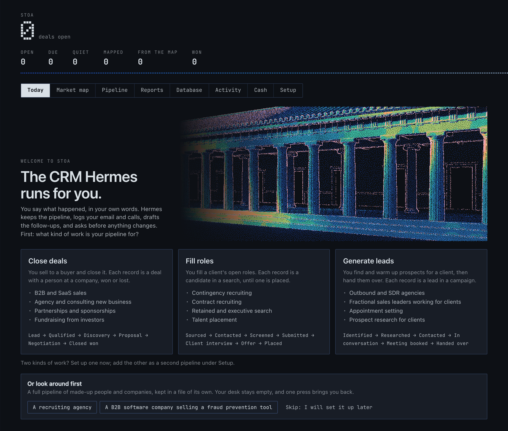
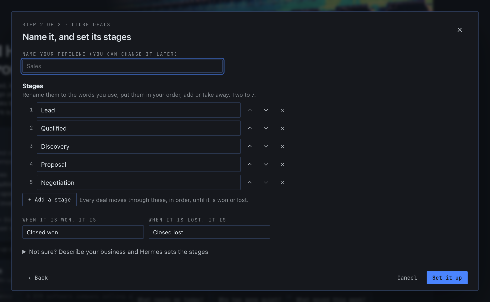
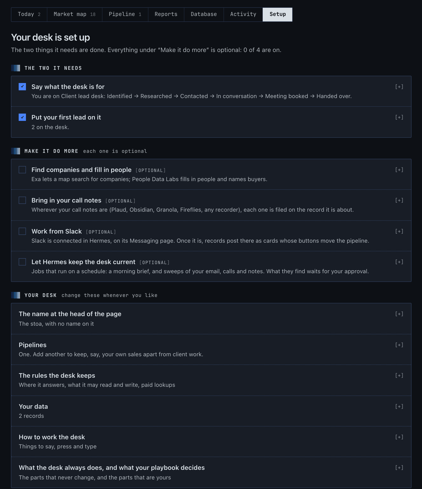
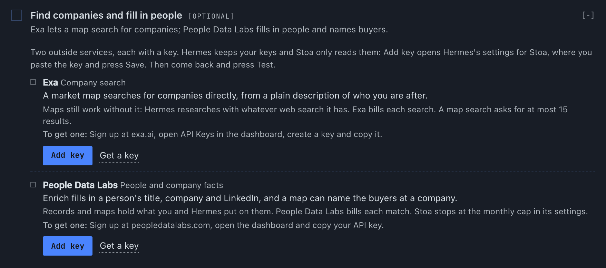
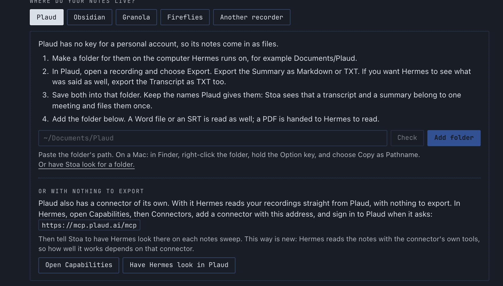
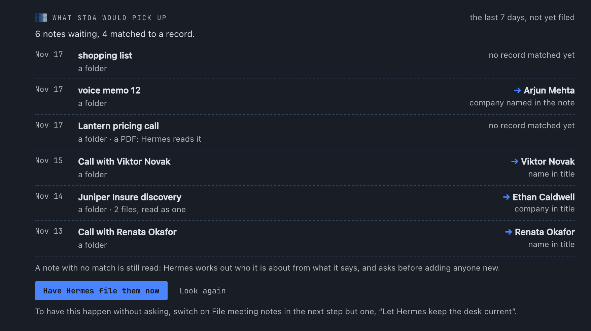
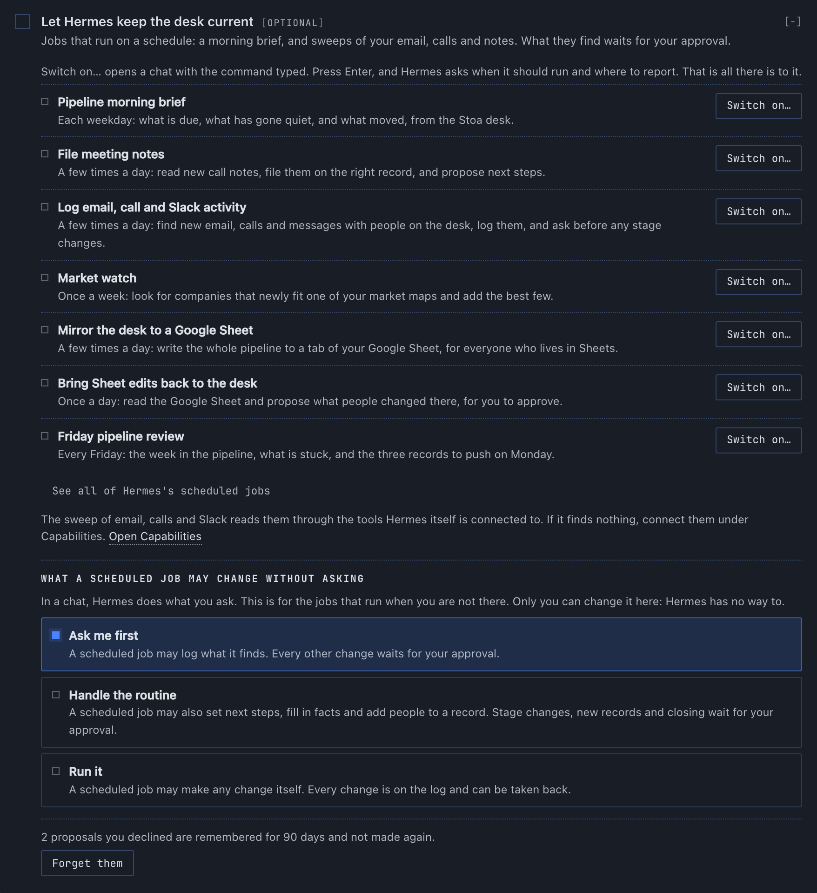

# Setting up Stoa

Four steps get you a working desk, in about five minutes. Four more are optional and can wait
until you want them. The **Setup** tab on the Stoa page walks through the same list and ticks
each step off as it is done.

| | Step | Where | |
|---|---|---|---|
| 1 | [Install it](#1-install-it) | A terminal | needed |
| 2 | [Switch on the page](#2-switch-on-the-page) | Hermes Desktop app or Webapp | needed |
| 3 | [Say what the desk is for](#3-say-what-the-desk-is-for) | The Stoa page | needed |
| 4 | [Put something on it](#4-put-something-on-it) | The Stoa page or any chat | needed |
| 5 | [Find companies and fill in people](#5-find-companies-and-fill-in-people) | Stoa → Setup | optional |
| 6 | [Bring in your call notes](#6-bring-in-your-call-notes) | Stoa → Setup | optional |
| 7 | [Work from Slack](#7-work-from-slack) | Hermes → Messaging | optional |
| 8 | [Let Hermes keep the desk current](#8-let-hermes-keep-the-desk-current) | Stoa → Setup | optional |

## Before you start

- **Hermes Agent 0.23.0 or later.** `hermes --version` says which you have.
- **The Hermes Desktop app or the Webapp**, for the Stoa page. Without either, the desk still
  works in a terminal and in any chat with `/gtm`.
- **A terminal on the machine Hermes runs on.**

## 1. Install it

```
hermes plugins install jarrett-del/hermes-stoa
hermes plugins enable stoa
hermes gateway restart
```

The restart is what makes Hermes load the plugin and bind its Slack buttons. To check it took,
run `hermes stoa status`.

`hermes plugins install stoa` installs from the Hermes plugin catalog instead. The catalog pins
a reviewed version, which can be behind the one described here.

## 2. Switch on the page

Open the Hermes Desktop app or the Webapp.

1. Go to **Capabilities → Plugins**.
2. Find **Stoa** and switch it on. If it is not listed, press **Rescan**.
3. **Stoa** now appears in the sidebar. Open it.

If the page says *The desk is not answering*, the plugin is not enabled or the gateway was not
restarted: go back to step 1.

## 3. Say what the desk is for

The first screen asks what kind of work your pipeline is for.



- **Close deals**, **Fill roles** or **Generate leads.** Pick the one that fits. It decides what
  a record is called (a deal, a candidate, a lead) and how work is billed.
- **Or look around first.** A tour is a full pipeline of made-up people and companies: a
  recruiting agency, or a company selling software. It lives in a file of its own and never
  touches your desk. **Leave the tour** ends it.

Then name the pipeline and set its stages in your own words: rename them, reorder them, add or
take away, from two to seven. Not sure? Describe your business and Hermes sets the stages for you.



You can change the stages later under **Setup → Edit stages**, and add a second pipeline there.

## 4. Put something on it

Any of these works:

- **Tell Hermes.** *"We are starting a Staff Backend search for Northwind. Add Dana Whitfield,
  call her Friday."*
- **Drop a list on the page.** A CSV of leads or candidates. Stoa shows what it would add and
  what it would change, and nothing is written until you press **Apply**.
- **Add one by hand.** **+ New** at the top of the page.
- **Map a market.** *"We sell a fraud prevention tool to fintechs and marketplaces. Who should
  we go after?"* Hermes researches it and the map appears on the **Market map** tab, where one
  press puts a company in your pipeline.

That is a working desk. Everything below makes it do more.

## Make it do more

Steps 5 to 8 are on **Stoa → Setup**, under **Make it do more**. Each is one line that says where
it stands. Press it and it opens onto the way to do it.



### 5. Find companies and fill in people

Stoa works without any key. Two outside services each add something:

| Key | What it adds | Cost |
|---|---|---|
| **Exa** | A market map searches for companies directly, from a plain description of who you are after | Exa bills each search |
| **People Data Labs** | **Enrich** fills in a person's title, company and LinkedIn, and a map can name the buyers at a company | Bills each match. Stoa stops at a monthly cap you set (50 to begin with) |



To add one:

1. Open the step and press **Get a key** on the service you want. Copy the key it gives you.
2. Press **Add key**. This opens Hermes's own settings for Stoa (also at **Settings → Plugins →
   Stoa**).
3. Paste the key into its box and press **Save settings**.
4. Back on **Stoa → Setup**, the row shows the key as set. Press **Test** to have the service
   confirm it.

Hermes keeps the key in its own settings file. Stoa reads it when it needs it and never shows it.

What **Test** costs: at People Data Labs it looks up an address nobody has, which is not billed.
At Exa it runs one search for one result, which Exa bills like any other search.

### 6. Bring in your call notes

Each note is filed on the record it is about, with the next step it implies. Stoa reads what your
recorder wrote (the summary, the transcript). It does not record or transcribe anything itself.

Open the step and pick where your notes live. It shows the way in for that tool.



| Your notes are in | How they reach the desk |
|---|---|
| **Plaud** | A folder: export each recording's summary (and transcript, if you like) into it. Or Plaud's own connector, through Hermes. |
| **Obsidian** | A folder: the one inside your vault where meeting notes go. |
| **Granola** | A key. In the Granola app, **Settings → Connectors → API keys → Create new key** (Business and Enterprise plans). |
| **Fireflies** | A key. In Fireflies, **Integrations → Fireflies API**. Stoa reads the summary and action items, never the transcript. |
| **Another recorder** (Otter, Fathom, tl;dv, Zoom, a phone's voice notes) | A folder: export or download each note as TXT, Markdown or Word. |

**A folder, step by step.**

1. Make a folder for your notes on the computer Hermes runs on, for example `Documents/Plaud`,
   and export or save your notes into it.
2. Paste the folder's path into the box. On a Mac: in Finder, right-click the folder, hold the
   Option key, and choose **Copy as Pathname**. Not sure where your notes are? **Or have Stoa
   look for a folder** tries a few usual places.
3. Press **Check**. Stoa says what is there: how many notes and of which kinds.
4. Press **Add folder**. You can add up to eight.

**See it work before any schedule runs.** Under the folders, **What Stoa would pick up** lists the
notes waiting and the record each one looks to be about. **Have Hermes file them now** hands them
to Hermes there and then. To have it happen without asking, switch on *File meeting notes* in
step 8.



Worth knowing:

- **What a folder may hold.** Markdown, text, Word (`.docx`), subtitle files (`.srt`, `.vtt`),
  web pages and rich text, in the folder and up to three folders below it. A PDF is handed to
  Hermes, which reads it with its own tools. A recording is only counted, so the page can tell
  you it has no words yet.
- **A transcript and a summary of one meeting,** saved as two files, are read as one note and
  filed once.
- **Who a note is about** is worked out from attendees listed at its head, a name or company in
  its title, and a person, an email address or a company named in what it says.
- **A note is filed once.** It stays filed if you edit, rename or move it. To have one gone
  through again, say so: *"go through my Juniper call note again"*.
- **Through a connector Hermes already has.** Plaud can be connected to Hermes directly: under
  **Capabilities → Connectors**, add a connector with the address `https://mcp.plaud.ai/mcp` and
  sign in. Back on this step, pick Plaud and press **Have Hermes look in Plaud**. This way is
  new, and how well it works depends on the connector.

### 7. Work from Slack

Slack is connected in Hermes, not in Stoa. Open the step and press **Open Messaging**, choose
Slack, and follow its steps. Once Hermes is in your Slack there is nothing more to do: records
post as cards whose buttons move the pipeline, and `!gtm` shows the board. Try
`!gtm Dana Whitfield` or `!gtm map`.

Two settings decide who can do what, both under **Settings → Plugins → Stoa**:

- **Limit to these chats.** The chat ids the desk answers in. Empty means everywhere.
- **Who may press Slack buttons.** Empty means only the person a card was posted for.

Both take Slack's own ids. For a person: open their profile in Slack, press the three dots, and
choose **Copy member ID**. For a channel: open the channel's details and copy the **Channel ID**
at the bottom.

### 8. Let Hermes keep the desk current

Seven jobs Hermes can run on a schedule: a morning brief, filing meeting notes, logging email,
call and Slack activity, a weekly market watch, a mirror to a Google Sheet, bringing Sheet edits
back, and a Friday review.



Press **Switch on…** beside one. A chat opens with the command typed. Press Enter, and Hermes
asks when it should run and where to report. Back on Setup, the job shows as on, with when it
runs next.

Under the list is **What a scheduled job may change without asking**. It starts on **Ask me
first**: a job may log what it finds, and every other change waits for your approval on Today.
Only you can change it. Hermes has no way to.

The sweep of email, calls and Slack reads them through the tools Hermes itself is connected to.
If it finds nothing, connect them under **Capabilities**.

## Pick your models

The Stoa page keeps two conversations of its own, and each runs on the model you pick for it.
Both lists are Hermes's own: every model your Hermes can use.

- **The talk box**, at the foot of every tab. The model's name sits under the box. Press it to
  change it.
- **Map research**, on the Market map tab. **Research:** beside **Map facts** sets the model
  Hermes uses to start a map, grow it and fill in what is missing.

They are independent, so the desk can run on a small model while maps are researched on a large
one, or the other way round. Slack, scheduled jobs and other chats stay on Hermes's default.

## Where everything is afterwards

- **Stoa → Setup** shows where things stand, and under **Your desk** the name on the page, your
  pipelines, the rules in force and your data with a CSV export.
- **Settings → Plugins → Stoa** is where every setting and key is changed.
- **Market map → Map facts** shows what a map holds and what it has cost, and is where you set
  limits on it: companies, dollars of Hermes's work a month, lookups and searches.
- **[Using Stoa](guide.md)** goes through a day on the desk, tab by tab.

## Updating

```
hermes plugins update stoa
hermes gateway restart
```

Then press **Rescan** under **Capabilities → Plugins** so the page picks up the new version. Your
desk is kept in Hermes's plugin-data folder and survives updates.

## If something is off

- **The page says the desk is not answering.** Enable the plugin and restart the gateway (step 1),
  then reload.
- **Stoa is not listed under Plugins, or the page looks unchanged after an update.** Press
  **Rescan** under **Capabilities → Plugins**.
- **A key shows as not set after you saved it.** Check you pressed **Save settings**, and that you
  are looking at the same profile you saved it in.
- **Test says the service refused the key.** Copy the key again from the service and save it. A
  missing first or last character is the usual cause.
- **Slack buttons do nothing after an update.** Restart the gateway so they bind to the new code.
